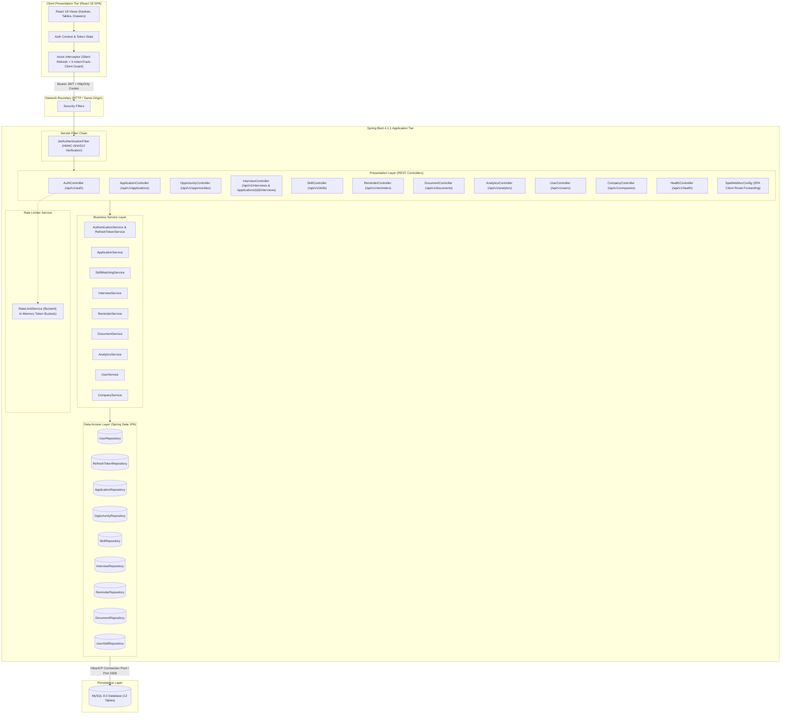

# InternTrack — Internship Application Intelligence Platform

[](https://openjdk.org/projects/jdk/21/)
[](https://spring.io/projects/spring-boot)
[](https://www.mysql.com/)
[](https://react.dev/)
[](https://vitejs.dev/)
[](https://playwright.dev/)
[](#system-architecture)

> **Full-stack internship and application tracking platform** engineered for software engineering students, new graduates, and technical job seekers. Couples a **Java 21 / Spring Boot 4.1.1 Modular Monolith** with a high-density, accessible **React 18 Single Page Application (SPA)**, featuring an in-memory deterministic skill gap analysis engine, dual-tier token-bucket rate limiting, and single-artifact production packaging.

---

## ⚡ 3-Minute Quick Start (Standalone Production Mode)

Launch the complete application from the standalone Fat JAR without needing an external web server:

```powershell
# 1. Clone the repository
git clone https://github.com/Milan-Goswami/Internship-Tracker.git
cd Internship-Tracker

# 2. Build the standalone Fat JAR (required on a fresh clone; .jar files are not tracked in git)
# If you downloaded a pre-built JAR release artifact, place it in backend/target/ and skip this step:
npm.cmd --prefix frontend install
npm.cmd --prefix frontend run build
.\backend\mvnw.cmd -f backend/pom.xml clean package -DskipTests

# 3. Configure environment variables & generate a secure 64-byte JWT secret
$env:PORT = "8080"
$env:DB_URL = "jdbc:mysql://localhost:3306/interntrack_dev?createDatabaseIfNotExist=true&useSSL=false&allowPublicKeyRetrieval=true&serverTimezone=UTC"
$env:DB_USERNAME = "root"
$env:DB_PASSWORD = "your_mysql_password"

# Generate a cryptographically secure 512-bit (64-byte) random secret key using .NET RandomNumberGenerator
$bytes = New-Object byte[] 64
[System.Security.Cryptography.RandomNumberGenerator]::Create().GetBytes($bytes)
$env:JWT_SECRET_KEY = [Convert]::ToBase64String($bytes)

# 4. Launch the standalone Fat JAR
java -jar backend/target/interntrack-api-0.0.1-SNAPSHOT.jar
```

> **Cryptographic Key Invariant:** `JwtService` evaluates the configured secret string directly as UTF-8 bytes via `rawSecret.getBytes(StandardCharsets.UTF_8)` and verifies `secretBytes.length >= 64` (minimum 512 bits for HMAC-SHA512). The command above generates an 88-character Base64 ASCII string (88 UTF-8 bytes $\ge 64$ bytes), fulfilling the cryptographic requirement without hardcoded strings. On Linux/macOS, use: `export JWT_SECRET_KEY=$(openssl rand -base64 64)`.

Open your browser to **`http://localhost:8080`**. Spring Boot automatically bootstraps the 12 normalized MySQL tables, seeds the 58-skill taxonomy, and serves the embedded React single-page application with deep-link client routing.

---

## 📑 Table of Contents

1. [Project Overview](#1-project-overview)
   - [The Problem with Spreadsheets](#the-problem-with-spreadsheets)
   - [Target Audience](#target-audience)
   - [Complete Candidate Journey](#complete-candidate-journey)
   - [Key Technical Highlights](#key-technical-highlights)
2. [Complete Feature Catalogue](#2-complete-feature-catalogue)
   - [Authentication & Session Lifecycle](#authentication--session-lifecycle)
   - [Command Center Dashboard](#command-center-dashboard)
   - [Applications Workspace (Kanban & Table)](#applications-workspace-kanban--table)
   - [Company Directory & Opportunities](#company-directory--opportunities)
   - [Skill Matrix & Deterministic Matching](#skill-matrix--deterministic-matching)
   - [Interview Preparation Hub](#interview-preparation-hub)
   - [Deadline & Follow-Up Reminders](#deadline--follow-up-reminders)
   - [Document Registry & Protocol Guard](#document-registry--protocol-guard)
   - [Funnel Intelligence & Analytics](#funnel-intelligence--analytics)
   - [Career Preferences & Profile Settings](#career-preferences--profile-settings)
   - [Global Command Bar & Keyboard Shortcuts](#global-command-bar--keyboard-shortcuts)
   - [Network Resilience & UI States](#network-resilience--ui-states)
3. [Beginner-Friendly User Guide](#3-beginner-friendly-user-guide)
4. [Technology Stack & Exact Versions](#4-technology-stack--exact-versions)
5. [System Architecture](#5-system-architecture)
   - [Architecture Diagram](#architecture-diagram)
   - [Request Lifecycle](#request-lifecycle)
   - [Token Rotation & Replay Revocation Lifecycle](#token-rotation--replay-revocation-lifecycle)
   - [Standalone Single-Artifact Packaging](#standalone-single-artifact-packaging)
   - [Repository Directory Structure](#repository-directory-structure)
6. [Deterministic Skill Gap Engine](#6-deterministic-skill-gap-engine)
   - [Mathematical Formula](#mathematical-formula)
   - [Canonical Normalization](#canonical-normalization)
   - [Illustrative Walkthrough](#illustrative-walkthrough)
7. [Security & Session Architecture](#7-security--session-architecture)
   - [Dual-Tier Rate Limiting](#dual-tier-rate-limiting)
   - [DEF-SEC-01 Transaction Rollback Remediation](#def-sec-01-transaction-rollback-remediation)
   - [Multi-Tenant Data Isolation](#multi-tenant-data-isolation)
8. [Database Schema & Persistence Manual](#8-database-schema--persistence-manual)
   - [The 12 Normalized Relational Tables](#the-12-normalized-relational-tables)
   - [Database Safety Invariant](#database-safety-invariant)
9. [Local Development Setup](#9-local-development-setup)
10. [Production Build & Packaging](#10-production-build--packaging)
11. [Testing & Verification Evidence](#11-testing--verification-evidence)
12. [REST API Reference](#12-rest-api-reference)
13. [Documentation Library](#13-documentation-library)
14. [Known Boundaries & Intentional Limitations](#14-known-boundaries--intentional-limitations)
15. [Troubleshooting & FAQ](#15-troubleshooting--faq)
16. [Project Status & Responsible Use](#16-project-status--responsible-use)
17. [Author & Links](#17-author--links)

---

## 1. Project Overview

### The Problem with Spreadsheets
When computer science students and technical candidates apply to 50–100+ internships per recruitment cycle, generic tools break down:
- **Spreadsheets lose temporal context:** Deadlines slip by without dynamic overdue highlighting or advance notice.
- **Lost interview reflection history:** Feedback, technical coding questions, and behavioral retrospectives get scattered across ephemeral notepad files.
- **Opaque qualification matching:** Job descriptions list laundry lists of requirements; candidates waste hours guessing whether their profile aligns with the role.
- **No conversion funnel visibility:** Applicants cannot see where they are dropping out (Resume Screening vs. Online Assessment vs. System Design).

### Target Audience
- **Computer Science & Engineering Students:** Managing high-volume summer and fall recruitment cycles.
- **Bootcamp Graduates & Career Switchers:** Organizing disciplined outreach campaigns with skill-gap tracking.
- **Technical Interviewers & Hiring Managers:** Evaluating candidate engineering maturity through an end-to-end full-stack portfolio codebase.

### Complete Candidate Journey
```
[ Register / Sign In ] ──> [ Set Career Preferences ] ──> [ Define 58-Taxonomy Skills ]
           │
           ▼
[ Explore Opportunities ] ──> [ Deterministic Skill Gap Analysis ] (Req 75% / Pref 25%)
           │
           ▼
[ Add Application ] ──> [ Move on Kanban / Dense Table ] (8 Granular Statuses)
           │
           ▼
[ Track Urgent Deadlines ] ──> [ Schedule Interview Rounds ] ──> [ Log Reflections & Outcomes ]
           │
           ▼
[ Link Resumes / Portfolios ] ──> [ Analyze Pipeline Funnel & Stage Conversions ]
```

### Key Technical Highlights
- **Java 21 LTS & Spring Boot 4.1.1:** Modern modular monolithic architecture with layered separation of concerns.
- **Stateless Bearer JWT + HttpOnly SameSite=Strict Refresh Cookie:** Cryptographic access tokens paired with rotated refresh tokens and replay attack detection.
- **DEF-SEC-01 Transactional Replay Revocation:** Solved an unchecked rollback bug to guarantee persistent token-family invalidation across concurrent sessions during token theft attempts.
- **Dual-Tier Bucket4j Rate Limiting:** Enforces in-memory token-bucket limits across IP addresses and user accounts.
- **High-Density React 18 SPA:** Custom dark slate design tokens (`#0B0F17`) built with vanilla CSS for zero CSS-in-JS runtime overhead.
- **Deterministic Mathematical Skill Engine:** Strict set-intersection formula evaluating candidate qualifications in sub-millisecond execution.
- **Single-Artifact Production Fat JAR:** Frontend Vite production assets compiled directly into Spring Boot's `BOOT-INF/classes/static/` with client SPA fallback routing.

---

## 2. Complete Feature Catalogue

### Authentication & Session Lifecycle
- **User Registration (`/register`):** Creates user credentials with BCrypt hashing ($k=10$), seeds a default candidate profile, and enforces RFC 5322 email formatting and password strength (8–100 characters). Guarded by a 3 registration/hr IP rate-limit bucket.
- **User Login (`/login`):** Authenticates credentials, returns an HMAC-SHA512 access token (15-minute expiration), and sets a secure HttpOnly, `SameSite=Strict` cookie (`refreshToken`, 7-day lifetime) scoped strictly to `/api/v1/auth`. Dual-tier rate limiting guards against brute-force attacks (10 requests/10 min per IP, 5 requests/15 min per email).
- **Silent Refresh Interceptor:** An Axios response interceptor catches HTTP 401 errors on protected routes, requests a rotated access token via `POST /api/v1/auth/refresh` with an `X-InternTrack-Client: web` CSRF header guard, and replays the original failed request seamlessly.
- **User Logout:** `POST /api/v1/auth/logout` invalidates the active database refresh token family, clears the browser cookie with `Max-Age=0`, removes in-memory authorization headers, and returns **`HTTP 204 No Content`**.

### Command Center Dashboard
- **Location:** `/dashboard`
- **KPI Summary Cards:** Instant aggregations displaying Total Applications, Active Pipelines, Interviewing Candidates, and Offers Received. Zero-divide protected when starting from an empty account.
- **Urgent Deadlines Widget:** Displays upcoming and overdue tasks with high-contrast color badges (`OVERDUE`, `<24h`, `Upcoming`). Provides an optimistic completion checkbox that updates the badge in real time.
- **Upcoming Interviews Pane:** Renders chronologically sorted interview rounds with interviewer names, round formats, and countdown indicators.
- **Action Hub:** One-click shortcuts to `+ New Application`, `+ Log Interview`, and `+ Set Reminder`.

### Applications Workspace (Kanban & Table)
- **Location:** `/applications`
- **8 Granular Application Stages:**
  - *Active Funnel:* `SAVED` ➔ `APPLIED` ➔ `SCREENING` ➔ `INTERVIEWING` ➔ `OFFER`
  - *Outcome States:* `ACCEPTED` ➔ `REJECTED` ➔ `WITHDRAWN`
- **Interactive Kanban Board:** Drag-and-drop or select stage transitions with instantaneous state machine verification.
- **Dense Table Workspace:** High-density table featuring multi-column sorting (Company, Role, Date, Salary, Status), pagination, and search filtering.
- **Batch Operations:** Multi-row checkbox selection with indeterminate header state, allowing bulk stage transitions (e.g., mark 5 applications as `INTERVIEWING` via `PATCH /api/v1/applications/batch-status`) or bulk deletion.
- **Keyboard Navigation:** Native table row roving `tabindex`, `j`/`k` keyboard shortcuts for row navigation, and `Enter` to open details.

### Company Directory & Opportunities
- **Location:** `/opportunities` (integrated Company catalog and custom employer registration)
- **Company Catalog:** Browse pre-seeded enterprise technology employers (Google, Microsoft, Amazon, Meta, Stripe) or create custom target companies with domain, industry, and headquarters metadata directly from the Opportunity creation drawer or REST API.
- **Opportunities Catalog:** View role level (`INTERNSHIP`, `NEW_GRAD`, `COOP`), compensation ranges, work modes (`REMOTE`, `HYBRID`, `ONSITE`), and application deadlines.
- **One-Click Pipeline Ingestion:** The "Apply" button on any opportunity instantly creates an associated candidate application in the `SAVED` or `APPLIED` stage.

### Skill Matrix & Deterministic Matching
- **Location:** `/skills`
- **Master Taxonomy:** 58 standardized industry skills organized into 6 categories: `LANGUAGE`, `FRAMEWORK`, `DATABASE`, `TOOL`, `CLOUD`, and `METHODOLOGY`.
- **Candidate Skill Profile:** Add skills with 4-tier semantic proficiency rankings: `BEGINNER`, `INTERMEDIATE`, `ADVANCED`, and `EXPERT`.
- **Instant Match Drawer:** Opening any opportunity displays an instant qualification badge calculated via mathematical set intersection, listing matching skills in green and missing required skills in amber for targeted resume tailoring.

### Interview Preparation Hub
- **Location:** `/interviews`
- **Round Scheduling:** Log rounds with round type (`SCREENING`, `TECHNICAL`, `BEHAVIORAL`, `SYSTEM_DESIGN`, `FINAL`), scheduled date/time, interviewer contacts, and meeting links.
- **Preparation Drawer:** Dedicated workspace to record algorithms, talking points, and company research before the interview.
- **Debrief & Outcomes:** Record post-round reflections, questions asked, difficulty ratings, and update round status (`PASSED`, `FAILED`, `RESCHEDULED`, `PENDING`).

### Deadline & Follow-Up Reminders
- **Location:** `/reminders`
- **Reminder Categories:** `APPLICATION_DEADLINE`, `OA_DEADLINE`, `INTERVIEW_PREP`, `FOLLOW_UP`, and `OTHER`.
- **Filter Tabs:** Tabbed filtering across `ALL`, `UPCOMING`, `OVERDUE`, and `COMPLETED`.
- **Optimistic State Updates:** Checkbox toggles instantly strike through completed items while asynchronously persisting state via `PATCH /api/v1/reminders/{id}/complete`.

### Document Registry & Protocol Guard
- **Location:** `/documents`
- **External Metadata Registry:** Stores metadata records and verified external cloud storage URLs (Google Drive, Dropbox, GitHub, LinkedIn) for resumes, cover letters, and transcripts.
- **URL Protocol Guard:** Strict backend sanitization rejects dangerous pseudo-schemes (`javascript:`, `file:`, `data:`) with HTTP 400, strictly permitting safe `http://` and `https://` URLs.
- **Safe Outbound Linking:** External links open with `target="_blank"` and `rel="noopener noreferrer"` attributes to prevent tab-nabbing vulnerabilities.

### Funnel Intelligence & Analytics
- **Location:** `/analytics`
- **Conversion Funnel Metrics:** Calculates stage-to-stage transition percentages ($SAVED \to APPLIED \to SCREENING \to INTERVIEWING \to OFFER$) to expose pipeline drop-off rates.
- **Pipeline Skill Deficits:** Aggregates all open applications to identify the top skills missing across the candidate's active opportunities.

### Career Preferences & Profile Settings
- **Location:** `/settings`
- **Candidate Profile:** Customize full name, target job title (e.g., *Software Engineering Intern*), target location, salary bounds (minimum and maximum hourly/annual rate), and preferred work mode.
- **Persistent Storage:** Changes are committed to `user_profiles` and reload seamlessly across browser sessions.

### Global Command Bar & Keyboard Shortcuts
- **Global Command Search (`/` or `Ctrl+K`):** Global search palette to quickly jump between Dashboard, Applications, Opportunities, Interviews, Reminders, and Settings.
- **Escape Key Handling:** Pressing `Escape` cleanly dismisses open modals, drawers, and command bars with focus restoration to the triggering button.

### Network Resilience & UI States
- **Offline Detection Banner:** Listens to `window.onoffline` and displays a persistent warning banner if connection drops.
- **Graceful Empty States:** Descriptive guidance cards and call-to-action buttons render when collections are empty.
- **High-Density Dark Theme:** Engineered according to WCAG 2.1 AA accessible contrast guidelines ($>4.5:1$) on a dark slate `#0B0F17` canvas with indigo focus rings (`#6366F1`) and semantic ARIA attributes (note: formal third-party assistive screen-reader certification has not been conducted).

---

## 3. Beginner-Friendly User Guide

Follow these verified walkthroughs to experience the complete platform:

### Step 1: Create an Account
1. Open `http://localhost:8080/register` (or `http://localhost:5173/register` in dev mode).
2. Enter your Full Name (e.g., `Alex Rivera`), Email (`alex@example.com`), and a secure password (minimum 8 characters).
3. Click **"Create Account"**. You will be logged in immediately and routed to the Dashboard.

### Step 2: Set Your Career Preferences
1. Click **Settings** in the left sidebar (or press `/` and type `Settings`).
2. Enter your Target Title (e.g., `Backend Engineering Intern`), Target Location (`San Francisco, CA`), Salary Range (`$45` to `$60` / hr), and select `HYBRID`.
3. Click **"Save Preferences"**.

### Step 3: Populate Your Skill Profile
1. Navigate to **Skills** in the sidebar.
2. Select category **LANGUAGE**, pick `Java`, choose proficiency **ADVANCED**, and click **"Add Skill"**.
3. Add `React` under **FRAMEWORK** (Proficiency: `INTERMEDIATE`), and `MySQL` under **DATABASE** (Proficiency: `ADVANCED`).

### Step 4: Create a Target Opportunity & Check Skill Match
1. Go to **Opportunities** ➔ Click **"+ Add Opportunity"**.
2. Select Company `Google`, Title `Software Engineer Intern, Systems`, Role Level `INTERNSHIP`, Work Mode `HYBRID`.
3. Add required skills: `Java`, `Spring Boot`, `SQL`.
4. Click **"Create Opportunity"**.
5. Click **"View Match"** on the card. The slide-over drawer calculates your qualification score, displaying `Java` and `SQL` as matched, while highlighting `Spring Boot` as a missing skill gap.

### Step 5: Track Your Application on the Kanban Board
1. In the Opportunity drawer, click **"Create Application"**.
2. Navigate to **Applications**. Your Google role appears in the `SAVED` column.
3. Drag the card or use the stage dropdown to advance the application to `APPLIED`, then `INTERVIEWING`.
4. Switch to **Table View** via the top toggle to inspect sorting and multi-row selection.

### Step 6: Schedule an Interview & Write Prep Notes
1. Navigate to **Interviews** ➔ Click **"+ Schedule Interview"**.
2. Link the round to your Google application.
3. Select Round Type **TECHNICAL**, set the date/time, and add Prep Notes: *"Review Binary Search Trees, Spring Transaction Propagation, and Bucket4j limits."*
4. Click **"Schedule Round"**. After the round, open the detail drawer, record your reflections, and mark the outcome as **PASSED**.

### Step 7: Set Deadline Reminders
1. Open **Reminders** ➔ Click **"+ Add Reminder"**.
2. Select Type **OA_DEADLINE**, set due date to tomorrow, and link to Google.
3. Return to **Dashboard** to see the urgent reminder card highlighted in the right pane.

---

## 4. Technology Stack & Exact Versions

| Component / Layer | Technology | Exact Version | Rationale & Responsibility |
| :--- | :--- | :--- | :--- |
| **Backend Runtime** | OpenJDK | `Java 21 LTS` | Modern Java features (Records, Pattern Matching, Sequenced Collections). |
| **Backend Framework** | Spring Boot | `4.1.1` | Jakarta EE 11 baseline (Servlet 6.1, Tomcat 11), Spring Security 7, Spring Framework 7. |
| **ORM / Data Access** | Hibernate / Spring Data | `7.4.5.Final` | Type-safe repositories, parameterized JPQL queries, HikariCP connection pooling. |
| **Relational Database** | MySQL Connector/J | `8.0+ / 26.7.0` | Transactional InnoDB engine, foreign key cascades, functional composite B-tree indexing. |
| **In-Memory Test DB** | H2 Database | `2.4.240` | Hermetic in-memory test isolation (`MODE=MySQL`) for zero-dependency CI test suites. |
| **Security & JWT** | JJWT | `0.12.6` | Stateless HMAC-SHA512 access tokens with cryptographic verification. |
| **Rate Limiter** | Bucket4j Core | `8.10.1` | In-memory token-bucket algorithm for IP and account brute-force protection. |
| **Frontend Framework** | React | `18.3.1` | Declarative UI, functional components, hooks, Context API state management. |
| **Frontend Router** | React Router DOM | `6.26.2` | Client-side routing, protected authorization gates, and public-only route wrappers. |
| **Build Tooling** | Vite | `5.4.21` | Sub-second HMR, optimized Rollup bundling, and production asset transformation. |
| **HTTP Client** | Axios | `1.7.7` | Interceptors for silent JWT refresh rotation, error translation, and credentials handling. |
| **Design System** | Custom Vanilla CSS | Design Tokens | High density, 4px grid rhythm, zero runtime CSS-in-JS overhead, WCAG 2.1 AA contrast. |
| **E2E Testing** | Playwright Chromium | `1.63.0` | Cross-viewport headless browser lifecycle and responsive layout verification. |
| **Unit Testing** | JUnit 5 & Vitest | `5.11 / 2.1.8` | 508 backend unit/integration tests and 68 frontend component/interaction tests. |
| **Build Plugins** | JaCoCo & OWASP DC | `0.8.12 / 12.1.0`| Code coverage analysis and automated CVE vulnerability auditing with verified suppressions. |

---

## 5. System Architecture

### Architecture Diagram



### Request Lifecycle
1. **User Action:** The candidate triggers an action in React (e.g., advancing an application stage on the Kanban board).
2. **Axios Dispatch:** Axios appends `Authorization: Bearer <token>` to the HTTP request.
3. **JWT Authentication Filter:** `JwtAuthenticationFilter` intercepts the request, validates the HMAC-SHA512 cryptographic signature and expiration, extracts candidate `userId`, and populates Spring's `SecurityContext`. (For public auth endpoints `/register`, `/login`, `/refresh`, `RateLimitService` enforces token-bucket limits before processing, rejecting exhausted callers with `HTTP 429 Too Many Requests`).
4. **Controller DTO Validation:** Controller validates input constraints via Jakarta Bean Validation (`@Valid`).
5. **Service Logic & Tenant Boundary:** Domain services enforce tenant ownership (`user_id = principal.id`), preventing unauthorized cross-user modifications.
6. **JPA Query Execution:** Spring Data JPA executes parameterized prepared statements against MySQL over the HikariCP pool.
7. **JSON Response:** Entity state is mapped to response DTOs and returned with standard HTTP status codes (`200 OK`, `201 Created`, `204 No Content`).

### Token Rotation & Replay Revocation Lifecycle

```mermaid
sequenceDiagram
    autonumber
    actor Candidate as Browser Client
    participant Server as Spring Boot API
    participant DB as MySQL (refresh_tokens)

    Note over Candidate, Server: Normal Token Refresh Flow
    Candidate->>Server: POST /api/v1/auth/refresh (Cookie: RT_1, Header: X-InternTrack-Client)
    Server->>DB: Query RT_1 by hash
    DB-->>Server: Token Valid (revoked = false, not expired)
    Server->>DB: Mark RT_1 revoked = true; INSERT RT_2 (New Hash)
    Server-->>Candidate: HTTP 200 OK (New Access Token, Cookie: RT_2)

    Note over Candidate, Server: Replay Attack Detection (Token Theft Attempt)
    actor Attacker as Malicious Replayer
    Attacker->>Server: POST /api/v1/auth/refresh (Replayed Cookie: RT_1)
    Server->>DB: Query RT_1 by hash
    DB-->>Server: Token Found (revoked = true)
    Note over Server: REUSE BREACH DETECTED!
    Server->>DB: UPDATE refresh_tokens SET revoked=true WHERE user_id = X
    Server->>DB: Explicit saveAllAndFlush() [DEF-SEC-01 Fix]
    Server-->>Attacker: HTTP 401 Unauthorized ("Token reuse detected")
    Note over Candidate: Candidate's other active sessions are safely terminated
```

### Standalone Single-Artifact Packaging
InternTrack packages both the frontend and backend into a single executable Fat JAR:
1. `npm.cmd run build` transforms 210 frontend React modules into optimized bundles in `frontend/dist/`.
2. Maven's `maven-resources-plugin` executes during `process-resources` and copies `frontend/dist/` into `${project.build.outputDirectory}/static` (`BOOT-INF/classes/static/`).
3. Spring Boot's `SpaWebMvcConfig` implements a regex-based forwarding controller: any client-side route without a file extension (e.g. `/dashboard`, `/applications/12`) is forwarded to `/index.html`, allowing React Router to manage client routes seamlessly while protecting `/api/**` REST routes.

### Repository Directory Structure
```
InternTrack/
├── backend/
│   ├── src/
│   │   ├── main/
│   │   │   ├── java/com/interntrack/api/
│   │   │   │   ├── config/          # Security, CORS, RateLimiting, SPA MVC configuration
│   │   │   │   ├── controller/      # 11 REST Controllers (Auth, Applications, Health, etc.)
│   │   │   │   ├── dto/             # Request / Response records and DTOs
│   │   │   │   ├── entity/          # 12 JPA Entities (User, Application, Opportunity, etc.)
│   │   │   │   ├── exception/       # Global exception handler & domain exceptions
│   │   │   │   ├── repository/     # 12 Spring Data JPA Repository interfaces
│   │   │   │   ├── security/       # JWT service, BCrypt service, Servlet filters
│   │   │   │   └── service/        # 13 Domain business services & Skill Matching engine
│   │   │   └── resources/
│   │   │       ├── application.yml  # Parameterized environment configuration
│   │   │       ├── schema.sql       # 12-table DDL schema definition
│   │   │       └── data.sql         # 58-skill taxonomy seed initialization
│   │   └── test/java/com/interntrack/api/  # 508 JUnit 5 / MockMvc automated tests
│   ├── dependency-check-suppressions.xml   # OWASP false-positive rules
│   └── pom.xml                             # Reconciled multi-plugin Maven POM
├── frontend/
│   ├── e2e/                         # Playwright Chromium E2E specs (13 tests)
│   ├── public/                      # Static assets (robots.txt, favicon)
│   ├── src/
│   │   ├── components/              # Shared components (Badge, Button, Toast, Modal)
│   │   ├── context/                 # AuthContext, ToastContext
│   │   ├── hooks/                   # Custom React hooks (useAuth)
│   │   ├── layouts/                 # AppLayout, AuthLayout
│   │   ├── pages/                   # 10 Application Views (Dashboard, Kanban, Skills, etc.)
│   │   ├── routes/                  # ProtectedRoute, PublicOnlyRoute, AppRoutes
│   │   ├── services/                # Axios API services
│   │   ├── styles/                  # tokens.css (Design tokens), global.css
│   │   └── test/                    # 68 Vitest unit/interaction tests
│   ├── package.json                 # React 18.3.1, Vite 5.4.21 dependencies
│   ├── vite.config.js               # Dev server proxy & build configuration
│   └── vitest.config.js             # JSDOM test runner configuration
├── docs/                            # Documentation library & audit reports
│   └── pdf/                         # 5 publication PDF deliverables (66 pages)
├── .env.example                     # Environment template with placeholders
├── .gitignore                       # Build, secret, and IDE artifact ignore rules
├── IMPLEMENTATION_ROADMAP.md        # Phase-by-phase implementation tracking
├── README.md                        # Master repository documentation (This file)
└── SYSTEM_ARCHITECTURE.md           # Architectural reference & specifications
```

---

## 6. Deterministic Skill Gap Engine

### Mathematical Formula
Instead of non-deterministic heuristic guessing or external LLM API calls, InternTrack evaluates candidate qualifications via a **mathematical set intersection algorithm**.

### Canonical Normalization
Before evaluating set intersection, skill names undergo canonical token normalization:
- Trim leading and trailing whitespace and downcase characters (`rawName.trim().toLowerCase(Locale.ROOT)`).
- **Canonical Alias Map (`Skill.ALIAS_MAP`):** Deterministically maps diverse industry aliases to unique canonical tokens:
  - `c++`, `cpp` $\to$ `cpp`
  - `c#`, `csharp` $\to$ `csharp`
  - `node.js`, `nodejs`, `node`, `node js` $\to$ `nodejs`
  - `react.js`, `reactjs`, `react`, `react js` $\to$ `react`
  - `.net core`, `asp.net core`, `dotnet core`, `netcore`, `asp.net` $\to$ `dotnetcore`
  - `spring boot`, `springboot` $\to$ `springboot`
  - `postgres`, `postgresql` $\to$ `postgresql`
- Whitespace collapsing and alphanumeric fallback stripping prevent spurious false negatives caused by punctuation or casing discrepancies.

### Set Partitioning & Scoring Logic
1. **Disjoint Requirement Partitioning:** An opportunity's skills are partitioned into two disjoint sets:
   $$\text{Required Skills } (R) \quad \text{and} \quad \text{Preferred Skills } (P)$$
2. **Weight Allocation:**
   - **Case A (Both Required and Preferred skills exist):**
     $$\text{Score} = \left( 0.75 \times \frac{|U \cap R|}{|R|} \right) + \left( 0.25 \times \frac{|U \cap P|}{|P|} \right)$$
   - **Case B (Only Required skills exist):**
     $$\text{Score} = \frac{|U \cap R|}{|R|}$$
   - **Case C (Only Preferred skills exist):**
     $$\text{Score} = \frac{|U \cap P|}{|P|}$$
   - **Case D (Zero skills specified on posting):** When $R = \emptyset$ and $P = \emptyset$, no arbitrary percentage is fabricated: returns `matchPercentage: null`, `matchLabel: "No Skills Specified"`, zero missing skills, and `zeroSkillsSpecified: true` (`OpportunitySkillMatchResponse`).
3. **Missing Skills Extraction:**
   $$\text{Missing Skills} = R \setminus U$$
   Any required skill not found in candidate skills ($U$) is surfaced as an actionable gap.

### Illustrative Walkthrough
*(For illustrative purposes)*
- **Opportunity Posting:**
  - Required ($R$): `{ Java, Spring Boot, MySQL, Docker }` ($|R| = 4$)
  - Preferred ($P$): `{ Kubernetes, AWS }` ($|P| = 2$)
- **Candidate Skills ($U$):**
  - `{ Java, MySQL, React, Git }`
- **Intersection:**
  - $|U \cap R| = |\{ \text{Java, MySQL} \}| = 2$
  - $|U \cap P| = 0$
- **Calculation:**
  $$\text{Score} = \left[\left(0.75 \times \frac{2}{4}\right) + \left(0.25 \times \frac{0}{2}\right)\right] \times 100 = 37.50\% \quad (\text{Threshold: } 0\% < \text{Score} < 50\% \implies \texttt{LOW})$$
- **Missing Skills Surfaced:** `{ Spring Boot, Docker }`

---

## 7. Security & Session Architecture

### Dual-Tier Rate Limiting
Enforced via Bucket4j token buckets stored in JVM memory:
- **`POST /api/v1/auth/register`:** Guarded by IP capacity (3 requests per 60 minutes).
- **`POST /api/v1/auth/login`:** Guarded by dual gates:
  - *IP Gate:* 10 requests per 10 minutes.
  - *Account Email Gate:* 5 requests per 15 minutes.
- **`POST /api/v1/auth/refresh`:** Guarded by IP capacity (20 requests per 1 minute).

### DEF-SEC-01 Transaction Rollback Remediation
In early testing, presenting a replayed (stolen) refresh token successfully detected the breach, but the accompanying call to revoke all sibling tokens in the user's token family was rolled back in MySQL. This occurred because `RefreshTokenService` threw an unchecked `InvalidTokenException` (`RuntimeException`), causing Spring's `@Transactional` to roll back the revocation writes.

**Remediation Implemented:**
```java
@Transactional(noRollbackFor = InvalidTokenException.class)
public TokenRotationResult rotateRefreshToken(String rawRefreshToken) {
    ...
    // Reuse detection: if token is already revoked, invalidate all active tokens for this user
    if (Boolean.TRUE.equals(refreshToken.getRevoked())) {
        revokeAllUserTokens(refreshToken.getUser().getId());
        throw new InvalidTokenException("Revoked refresh token presented: possible token reuse detected");
    }
    ...
}

public void revokeAllUserTokens(Long userId) {
    List<RefreshToken> activeTokens = refreshTokenRepository.findByUserIdAndRevokedFalse(userId);
    for (RefreshToken token : activeTokens) {
        token.setRevoked(true);
        token.setRevokedAt(Instant.now());
    }
    refreshTokenRepository.saveAllAndFlush(activeTokens);
}
```
Verified via integration tests (`RefreshTokenFamilyRevocationIntegrationTest`) and live HTTP security gates (`SEC-GATE-01` and `SEC-GATE-02`). Replaying a compromised token persists revocation across MySQL and invalidates all concurrent sessions for that user while returning HTTP 401.

### Multi-Tenant Data Isolation
Every data access operation across all operational domains (Applications, Interviews, Documents, Reminders, Opportunities, Profiles, Analytics) enforces tenant scoping:
- Endpoints inject the authenticated principal: `@AuthenticationPrincipal AuthenticatedUser user`.
- Service queries strictly filter by `user.id`:
  ```java
  @Query("SELECT a FROM Application a WHERE a.id = :id AND a.user.id = :userId")
  Optional<Application> findByIdAndUserId(@Param("id") Long id, @Param("userId") Long userId);
  ```
- Cross-tenant access attempts return **`HTTP 403 Forbidden`** or **`HTTP 404 Not Found`** without leaking data existence. Verified via live tests (`API-SEC-02` through `API-SEC-08`).

---

## 8. Database Schema & Persistence Manual

### The 12 Normalized Relational Tables
Created deterministically via [backend/src/main/resources/schema.sql](backend/src/main/resources/schema.sql) with exact referential integrity constraints:

1. **`users`:** Candidate authentication credentials, BCrypt password hash, full name, role (`ROLE_USER`), active flag, and timestamps (`uk_user_email` unique key).
2. **`user_profiles`:** Candidate target job title, location, salary min/max bounds, and work mode preference. Enforces `FOREIGN KEY (id) REFERENCES users(id) ON DELETE CASCADE`.
3. **`companies`:** Employer directory with canonical name, domain, industry, and headquarters (`uk_company_canonical` unique key).
4. **`skills`:** Master technical taxonomy containing 58 skills across 6 categories (`uk_skill_canonical` unique key).
5. **`opportunities`:** Job postings with compensation ranges, deadline, work mode, and deduplication SHA-256 hash. Enforces `FOREIGN KEY (company_id) REFERENCES companies(id) ON DELETE RESTRICT` (prevents deleting employers with open opportunities) and `FOREIGN KEY (created_by_user_id) REFERENCES users(id) ON DELETE SET NULL`.
6. **`opportunity_skills`:** Junction table linking opportunities to required vs. preferred taxonomy skills (`uk_opp_skill` composite key). Enforces `ON DELETE CASCADE` from both `opportunities` and `skills`.
7. **`user_skills`:** Candidate skill proficiencies (`BEGINNER`, `INTERMEDIATE`, `ADVANCED`, `EXPERT`) and years of experience (`uk_user_skill` composite key). Enforces `ON DELETE CASCADE` from both `users` and `skills`.
8. **`applications`:** Core candidate pipeline tracking table with 8 statuses, notes, ratings (`uk_app_user_opp` composite key). Enforces `FOREIGN KEY (opportunity_id) REFERENCES opportunities(id) ON DELETE RESTRICT` (protects opportunities with active candidate applications) and `FOREIGN KEY (user_id) REFERENCES users(id) ON DELETE CASCADE`.
9. **`interviews`:** Interview round schedules, round types, interviewer contacts, preparation notes, outcomes, and reflections. Enforces `FOREIGN KEY (application_id) REFERENCES applications(id) ON DELETE CASCADE`.
10. **`documents`:** Registry of external document URLs (resumes, cover letters, transcripts). Enforces `FOREIGN KEY (user_id) REFERENCES users(id) ON DELETE CASCADE`.
11. **`reminders`:** Follow-up deadlines, completion boolean flags, and reminder types. Enforces `FOREIGN KEY (application_id) REFERENCES applications(id) ON DELETE SET NULL` (preserves reminder history when an application is deleted) and `FOREIGN KEY (user_id) REFERENCES users(id) ON DELETE CASCADE`.
12. **`refresh_tokens`:** Stores SHA-256 hashes of issued refresh tokens, expiration timestamps, and revocation flags (`uk_refresh_token_hash`). Enforces `FOREIGN KEY (user_id) REFERENCES users(id) ON DELETE CASCADE`.

### Database Safety Invariant
> [!IMPORTANT]
> **Production Database Protection Rule:**  
> The production database `interntrack_db` is strictly protected. Automated test suites run exclusively against in-memory H2 (`jdbc:h2:mem:testdb;MODE=MySQL`). Live verification and local development must always use an isolated database (e.g., `interntrack_dev` or `interntrack_demo_db`). Never run disposable scripts against `interntrack_db`.

---

## 9. Local Development Setup

### Prerequisites
- **Java 21 LTS** (`java -version`)
- **Node.js 18+ & npm** (`node -v` / `npm -v`)
- **MySQL 8.0+** running locally on port `3306`

### 1. Database Initialization
Create a dedicated local development database:
```sql
CREATE DATABASE interntrack_dev CHARACTER SET utf8mb4 COLLATE utf8mb4_unicode_ci;
```
*(Spring Boot automatically initializes tables and seed data from `schema.sql` and `data.sql` on startup).*

### 2. Configure Environment Variables
Spring Boot resolves configuration from process environment variables and Java system properties (it does **not** natively parse a plain `.env` file without an external loader). Export these variables in your active shell session or configure them in your IDE Run Configuration:

```powershell
# Windows PowerShell 5.1+ / PowerShell Core
$env:PORT = "8080"
$env:DB_URL = "jdbc:mysql://localhost:3306/interntrack_dev?useSSL=false&serverTimezone=UTC"
$env:DB_USERNAME = "root"
$env:DB_PASSWORD = "your_mysql_password"

# Generate a cryptographically secure 512-bit (64-byte) random secret key using .NET RandomNumberGenerator
$bytes = New-Object byte[] 64
[System.Security.Cryptography.RandomNumberGenerator]::Create().GetBytes($bytes)
$env:JWT_SECRET_KEY = [Convert]::ToBase64String($bytes)
```

### 3. Launch Backend Development Server
```powershell
cd backend
.\mvnw.cmd spring-boot:run
```
Backend will start on `http://localhost:8080`. Verify health:
```powershell
curl http://localhost:8080/api/v1/health
# Returns: {"status":"UP"}
```

### 4. Launch Frontend Development Server
In a separate terminal:
```powershell
cd frontend
npm.cmd install
npm.cmd run dev
```
Vite development server will start on `http://localhost:5173`. API calls to `/api` are automatically proxied to `http://localhost:8080`.

---

## 10. Production Build & Packaging

InternTrack compiles the React SPA and packages it directly into a standalone runnable Fat JAR:

```powershell
# Step 1: Compile the frontend production bundle (210 modules)
cd frontend
npm.cmd run build
cd ..

# Step 2: Package the Spring Boot standalone Fat JAR
cd backend
.\mvnw.cmd clean package -DskipTests
cd ..
```

### Running the Standalone Fat JAR
```powershell
$env:PORT = "8080"
$env:DB_URL = "jdbc:mysql://localhost:3306/interntrack_dev?useSSL=false&serverTimezone=UTC"
$env:DB_USERNAME = "root"
$env:DB_PASSWORD = "your_mysql_password"

# Generate a cryptographically secure 512-bit (64-byte) random secret key using .NET RandomNumberGenerator
$bytes = New-Object byte[] 64
[System.Security.Cryptography.RandomNumberGenerator]::Create().GetBytes($bytes)
$env:JWT_SECRET_KEY = [Convert]::ToBase64String($bytes)

java -jar backend/target/interntrack-api-0.0.1-SNAPSHOT.jar
```
Open **`http://localhost:8080`**. Both the frontend SPA and backend REST APIs operate seamlessly on a single port.

---

## 11. Testing & Verification Evidence

All test suites have been verified with 100% reproducible pass rates:

| Verification Tier / Category | Test Harness | Scope & Execution Environment | Verified Count | Exit Code | Target DB / Environment |
| :--- | :--- | :--- | :---: | :---: | :--- |
| **Automated Backend Suite** | JUnit 5 / Spring Boot Test | Controllers, security, services, repositories | **508 / 508** | `0` | Hermetic H2 (`jdbc:h2:mem:testdb;MODE=MySQL`) |
| **Automated Frontend Unit** | Vitest / React Testing Library | Component interaction, keyboard navigation, focus traps | **68 / 68** | `0` | JSDOM (10 test suites) |
| **Playwright Chromium E2E** | Playwright Chromium Headless | Complete candidate journeys across 5 responsive viewports | **13 / 13** | `0` | Isolated QA Server |
| **Live REST API Functional** | Node.js Axios Harness | Complete HTTP contracts across all 11 domain controllers | **41 / 41** | `0` | Dedicated DB (`interntrack_live_reconcile`) |
| **Mandatory Live Security Gates**| Node.js Axios Harness | Token rotation, family breach revocation, tenant isolation | **3 / 3** | `0` | Dedicated DB (`interntrack_live_reconcile`) |
| **Standalone Fat JAR Smoke Routes**| Node.js HTTP Harness | Client SPA deep-links (`/dashboard`, `/applications`) | **5 / 5** | `0` | Embedded Tomcat (Port 8080) |
| **Frontend Production Build** | Vite / Rollup | Complete compilation of 210 frontend modules | **210 modules**| `0` | Zero bundling or syntax errors |
| **Fat JAR Standalone Packaging**| Maven Package Plugin | Embedding `frontend/dist/` into `BOOT-INF/classes/static/` | **1 / 1 JAR** | `0` | Single runnable artifact |
| **OWASP Dependency-Check** | OWASP Maven Plugin | Automated CVE vulnerability audit with suppressions | **0 CVEs** | `0` | Local NVD CVE Database |
| **PDF Publication Assertions** | PDF.js Automated Parser | Text assertions, page counts across 5 publication PDFs | **19 / 19** | `0` | Generated PDFs (`docs/pdf/`) |
| **Manual Live Workflows** | Chrome Browser Subagent | Empirical full-lifecycle candidate journey validation | **28 / 28** | `0` | Full live application verification |
| **TOTAL VERIFICATIONS** | | **589 Automated Code Tests + 49 Live Probes + 19 PDF Assertions + 28 Manual Workflows** | **685 Total** | `0` | **100% PASS** |

### Reproducing the Automated Test Suites (589 Tests)

The 589 automated code tests can be executed locally using the verified commands below.

#### 1. Backend Automated Suite (508 Tests)
Runs the complete JUnit 5 / Spring Boot test suite:
```powershell
# From the repository root
.\backend\mvnw.cmd -f backend/pom.xml test

# Or from the backend directory
cd backend
.\mvnw.cmd test
```
- **Prerequisites:** Java 21 JDK installed.
- **Environment & Safety:** Fully hermetic. Tests run against an isolated in-memory H2 database (`jdbc:h2:mem:testdb;MODE=MySQL`). No running MySQL server or external credentials required. Tests never interact with the protected database `interntrack_db`.
- **Linux/macOS:** `./backend/mvnw -f backend/pom.xml test`

#### 2. Frontend Unit & Component Suite (68 Tests)
Runs 10 Vitest test suites verifying UI components, custom hooks, keyboard navigation, and modal focus traps:
```powershell
# From the repository root
npm.cmd --prefix frontend test

# Or from the frontend directory
cd frontend
npm.cmd test
```
- **Prerequisites:** Node.js 18+ installed; frontend dependencies installed (`npm.cmd --prefix frontend install`).
- **Environment:** Executes completely in JSDOM memory with mocked API services. No running backend or database required.
- **Linux/macOS:** `npm --prefix frontend test`

#### 3. Playwright Chromium End-to-End Suite (13 Tests)
Runs automated browser candidate journeys across 5 responsive viewports:
```powershell
# From the repository root
npx --prefix frontend playwright test --project=chromium

# Or from the frontend directory
cd frontend
npx playwright test --project=chromium
```
- **Prerequisites:** Playwright Chromium binaries installed (`npx --prefix frontend playwright install chromium`).
- **Environment & Safety:** Requires an active backend server running on `http://localhost:8080`. Playwright's webServer configuration automatically spins up the frontend Vite server at `http://localhost:5173`. When testing against a live server, always configure a dedicated throwaway test database (e.g. `interntrack_qa`). Never execute tests against the protected production database `interntrack_db`.
- **Linux/macOS:** `npx --prefix frontend playwright test --project=chromium`

### Verification Scope Distinction

To maintain technical precision, the 685 total verification count is partitioned into automated code suites and pre-publication QA audits:
- **589 Automated Code Tests:** Reproducible on demand using the CLI commands above (508 JUnit 5 + 68 Vitest + 13 Playwright Chromium).
- **96 Extended QA & Audit Verifications:** Executed during the formal pre-publication verification lifecycle and documented with timestamped test logs in [docs/INTERNTRACK_FULL_LIVE_QA_REPORT.md](docs/INTERNTRACK_FULL_LIVE_QA_REPORT.md) and [docs/INTERNTRACK_MASTER_AUDIT_FINAL_REPORT.md](docs/INTERNTRACK_MASTER_AUDIT_FINAL_REPORT.md). These comprise:
  - **41 Live REST API Functional Probes:** Executed by an automated Node.js Axios harness against a dedicated disposable live database (`interntrack_live_reconcile`).
  - **3 Mandatory Live Security Gate Probes:** Validated token rotation, token family breach revocation, and multi-tenant data isolation.
  - **5 Standalone Fat JAR Smoke Checks:** Verified SPA client deep-links served by embedded Tomcat on port 8080.
  - **210 Frontend Module Compilation Assertions:** Verified zero bundling or syntax errors via Vite/Rollup.
  - **1 Fat JAR Packaging Check:** Verified embedding of `frontend/dist/` into `BOOT-INF/classes/static/`.
  - **0-CVE OWASP Audit:** Verified zero vulnerabilities with suppressions via the OWASP Dependency-Check plugin.
  - **19 PDF Parser Assertions:** Verified text extraction and page counts across all 5 publication deliverables via PDF.js.
  - **28 Manual Browser Journeys:** Validated full-lifecycle candidate interactive workflows in Chromium.

---

## 12. REST API Reference

All REST endpoints are prefixed with `/api/v1` and return JSON payloads:

| Domain | Method | Endpoint | Access Guard | Description |
| :--- | :---: | :--- | :--- | :--- |
| **Auth** | `POST` | `/api/v1/auth/register` | Public (IP Rate-Limited) | Register candidate account (`fullName`, `email`, `password`). Returns HTTP 201. |
| **Auth** | `POST` | `/api/v1/auth/login` | Public (Dual Rate-Limited) | Authenticate credentials; returns Bearer JWT and sets HttpOnly refresh cookie. |
| **Auth** | `POST` | `/api/v1/auth/refresh` | Public (CSRF-Guarded) | Rotates refresh token and issues new access token (`X-InternTrack-Client: web`). |
| **Auth** | `POST` | `/api/v1/auth/logout` | Authenticated | Revokes refresh token family; returns HTTP 204 No Content. |
| **Users** | `GET` | `/api/v1/users/me` | Authenticated | Fetch authenticated user profile & career preferences. |
| **Users** | `PUT` | `/api/v1/users/me` | Authenticated | Full update of target title, location, salary bounds, and work mode. |
| **Users** | `PATCH` | `/api/v1/users/me` | Authenticated | Partial update of target career preferences. |
| **Applications** | `GET` | `/api/v1/applications` | Authenticated | List candidate applications with optional `status` filter. |
| **Applications** | `POST` | `/api/v1/applications` | Authenticated | Create application for an opportunity (`SAVED` or `APPLIED`). Returns HTTP 201. |
| **Applications** | `GET` | `/api/v1/applications/{id}` | Authenticated | Fetch single application details with linked opportunity and company. |
| **Applications** | `PATCH` | `/api/v1/applications/{id}/status` | Authenticated | Advance application stage (`SAVED` $\to$ `OFFER`). |
| **Applications** | `PATCH` | `/api/v1/applications/batch-status` | Authenticated | Batch mutate stages across multiple selected applications. |
| **Applications** | `PUT` | `/api/v1/applications/{id}` | Authenticated | Update personal notes and rating for an application. |
| **Applications** | `DELETE`| `/api/v1/applications/{id}` | Authenticated | Delete application record and cascade children. Returns HTTP 204. |
| **Opportunities** | `GET` | `/api/v1/opportunities` | Authenticated | Browse opportunities with role level and work mode filters. |
| **Opportunities** | `POST` | `/api/v1/opportunities` | Authenticated | Create opportunity posting with required and preferred skills. Returns HTTP 201. |
| **Opportunities** | `GET` | `/api/v1/opportunities/{id}` | Authenticated | Fetch opportunity details by ID. |
| **Opportunities** | `GET` | `/api/v1/opportunities/{id}/skill-match` | Authenticated | Calculate deterministic skill match score and gap analysis. |
| **Opportunities** | `PUT` | `/api/v1/opportunities/{id}` | Authenticated | Update opportunity details and requirements. |
| **Opportunities** | `DELETE`| `/api/v1/opportunities/{id}` | Authenticated | Delete opportunity posting. Returns HTTP 204. |
| **Companies** | `GET` | `/api/v1/companies` | Authenticated | Search company directory by name and industry. |
| **Companies** | `POST` | `/api/v1/companies` | Authenticated | Register a new target company entity. Returns HTTP 201. |
| **Companies** | `GET` | `/api/v1/companies/{id}` | Authenticated | Fetch company details by ID. |
| **Skills** | `GET` | `/api/v1/skills/search` | Authenticated | Search 58-skill taxonomy catalog by keyword and category. |
| **Skills** | `GET` | `/api/v1/skills/user` | Authenticated | Fetch candidate's active skill matrix. |
| **Skills** | `POST` | `/api/v1/skills/user` | Authenticated | Add skill to candidate profile with proficiency level. Returns HTTP 201. |
| **Skills** | `DELETE`| `/api/v1/skills/user/{skillId}` | Authenticated | Remove skill from candidate profile. Returns HTTP 204. |
| **Interviews** | `GET` | `/api/v1/applications/{appId}/interviews` | Authenticated | List interview rounds linked to a specific application. |
| **Interviews** | `POST` | `/api/v1/applications/{appId}/interviews`| Authenticated | Schedule an interview round with prep notes. Returns HTTP 201. |
| **Interviews** | `GET` | `/api/v1/interviews/{interviewId}` | Authenticated | Fetch round details by interview ID. |
| **Interviews** | `PUT` | `/api/v1/interviews/{interviewId}` | Authenticated | Update interview schedule, contacts, or prep notes. |
| **Interviews** | `PATCH` | `/api/v1/interviews/{interviewId}/outcome` | Authenticated | Record interview outcome (`PASSED`, `FAILED`) and reflection notes. |
| **Interviews** | `DELETE`| `/api/v1/interviews/{interviewId}` | Authenticated | Delete interview round. Returns HTTP 204. |
| **Reminders** | `GET` | `/api/v1/reminders` | Authenticated | List reminders with optional `completed` boolean filter. |
| **Reminders** | `POST` | `/api/v1/reminders` | Authenticated | Create deadline reminder linked to an application. Returns HTTP 201. |
| **Reminders** | `GET` | `/api/v1/reminders/{id}` | Authenticated | Fetch reminder details by ID. |
| **Reminders** | `PATCH` | `/api/v1/reminders/{id}/complete` | Authenticated | Optimistically toggle reminder completion state. |
| **Reminders** | `PUT` | `/api/v1/reminders/{id}` | Authenticated | Update reminder due date, title, or category. |
| **Reminders** | `DELETE`| `/api/v1/reminders/{id}` | Authenticated | Delete reminder. Returns HTTP 204. |
| **Documents** | `GET` | `/api/v1/documents` | Authenticated | List candidate's external resume/portfolio document links. |
| **Documents** | `POST` | `/api/v1/documents` | Authenticated | Register document URL metadata (sanitized HTTP/HTTPS only). Returns HTTP 201. |
| **Documents** | `GET` | `/api/v1/documents/{id}` | Authenticated | Fetch document metadata by ID. |
| **Documents** | `PUT` | `/api/v1/documents/{id}` | Authenticated | Update document title, version tag, or URL. |
| **Documents** | `DELETE`| `/api/v1/documents/{id}` | Authenticated | Delete document metadata record. Returns HTTP 204. |
| **Analytics** | `GET` | `/api/v1/analytics/summary` | Authenticated | Aggregated KPI summary metrics (total, active, offers, rate). |
| **Analytics** | `GET` | `/api/v1/analytics/funnel` | Authenticated | Pipeline conversion funnel metrics across 8 stages. |
| **Analytics** | `GET` | `/api/v1/analytics/skill-deficits` | Authenticated | Top missing taxonomy skills across active applications. |
| **Health** | `GET` | `/api/v1/health` | Public | System liveness health check (`{"status":"UP"}`). |

*For complete endpoint request/response payloads, see the [Complete Project Reference](docs/INTERNTRACK_COMPLETE_PROJECT_REFERENCE.md).*

---

## 13. Documentation Library

Comprehensive technical documentation and publication PDF deliverables are available in the repository:

### Markdown Technical Guides (`docs/`)
| Document | Relative Path | Purpose & Target Audience |
| :--- | :--- | :--- |
| **Complete User Manual** | [docs/INTERNTRACK_COMPLETE_USER_MANUAL.md](docs/INTERNTRACK_COMPLETE_USER_MANUAL.md) | 24-chapter beginner walkthrough with verified click paths and troubleshooting. |
| **Technical Interview Handbook** | [docs/INTERNTRACK_INTERVIEW_TECHNICAL_HANDBOOK.md](docs/INTERNTRACK_INTERVIEW_TECHNICAL_HANDBOOK.md) | Architectural teardowns, ER models, DEF-SEC-01 deep dive, and 60+ technical interview Q&As. |
| **Complete Project Reference** | [docs/INTERNTRACK_COMPLETE_PROJECT_REFERENCE.md](docs/INTERNTRACK_COMPLETE_PROJECT_REFERENCE.md) | Code inventory of 11 controllers, 48 endpoints, 12 tables, and component maps. |
| **Master Audit Final Report** | [docs/INTERNTRACK_MASTER_AUDIT_FINAL_REPORT.md](docs/INTERNTRACK_MASTER_AUDIT_FINAL_REPORT.md) | Quality assurance audit report and readiness certification. |
| **Full Live QA Report** | [docs/INTERNTRACK_FULL_LIVE_QA_REPORT.md](docs/INTERNTRACK_FULL_LIVE_QA_REPORT.md) | Empirical live verification report across browser and API tiers. |
| **DEF-SEC-01 Remediation Report**| [docs/INTERNTRACK_DEF_SEC_01_REMEDIATION_REPORT.md](docs/INTERNTRACK_DEF_SEC_01_REMEDIATION_REPORT.md) | In-depth security analysis and transactional fix for token replay attacks. |
| **QA Test Summary** | [docs/INTERNTRACK_QA_TEST_SUMMARY.md](docs/INTERNTRACK_QA_TEST_SUMMARY.md) | High-level summary of test suite composition and exit codes. |
| **Complete Guide** | [docs/INTERNTRACK_COMPLETE_GUIDE.md](docs/INTERNTRACK_COMPLETE_GUIDE.md) | Comprehensive monolithic reference combining user manual and architecture. |

### Publication PDF Deliverables (`docs/pdf/`)
| Deliverable Name | File Path | Format & Page Count | Description |
| :--- | :--- | :---: | :--- |
| **User Manual (PDF)** | [docs/pdf/InternTrack_Complete_User_Manual.pdf](docs/pdf/InternTrack_Complete_User_Manual.pdf) | PDF (14 Pages) | High-fidelity publication PDF manual for end users. |
| **Technical Handbook (PDF)**| [docs/pdf/InternTrack_Technical_Interview_Handbook.pdf](docs/pdf/InternTrack_Technical_Interview_Handbook.pdf) | PDF (24 Pages) | Comprehensive technical interview and architecture handbook. |
| **Project Reference (PDF)** | [docs/pdf/InternTrack_Complete_Project_Reference.pdf](docs/pdf/InternTrack_Complete_Project_Reference.pdf) | PDF (11 Pages) | Ground-truth code, API, and database entity inventory. |
| **QA Report (PDF)** | [docs/pdf/InternTrack_Full_QA_and_Verification_Report.pdf](docs/pdf/InternTrack_Full_QA_and_Verification_Report.pdf) | PDF (9 Pages) | Comprehensive QA evidence and defect remediation record. |
| **Master Audit Report (PDF)**| [docs/pdf/InternTrack_Master_Audit_Final_Report.pdf](docs/pdf/InternTrack_Master_Audit_Final_Report.pdf) | PDF (8 Pages) | Executive audit verdict and safety compliance certification. |

---

## 14. Known Boundaries & Intentional Limitations

To maintain 100% technical transparency:
1. **In-Memory Rate Limiting:** Bucket4j stores rate-limiting token buckets in JVM in-memory storage. For single-instance deployments, this provides nanosecond execution without network latency. In a multi-node horizontal cluster, Redis-backed token buckets would be required.
2. **External Document URL Metadata:** The Document Registry stores external verified URLs (Google Drive, Dropbox, GitHub) rather than hosting raw binary resume blobs directly in MySQL.
3. **Deterministic Exact Skill Matching:** Skill matching uses normalized exact string set intersection rather than probabilistic vector embeddings.
4. **Local Performance Benchmarks:** Sub-millisecond skill calculations and under-150ms indexed queries were observed on local development hardware; they reflect benchmark observations rather than universal production SLAs.
5. **No Hosted Cloud Deployment:** The application is architected and packaged as a standalone runnable Fat JAR and local development environment; no public production URL is currently hosted.
6. **Accessibility Scope:** Engineered according to semantic HTML and WCAG 2.1 AA compliant contrast guidelines; formal third-party manual screen-reader audits (e.g. JAWS, NVDA) have not been conducted.

---

## 15. Troubleshooting & FAQ

### Q: `Access denied for user 'root'@'localhost'`
- **Cause:** Incorrect MySQL password in your environment.
- **Fix:** Verify `$env:DB_PASSWORD` matches your local MySQL server password.

### Q: `JWT_SECRET_KEY is required and must be at least 64 bytes`
- **Cause:** `JwtService` evaluates the configured secret's UTF-8 byte length via `rawSecret.getBytes(StandardCharsets.UTF_8).length >= 64`, requiring at least 64 bytes (512 bits) for HMAC-SHA512 (`Keys.hmacShaKeyFor`). A string shorter than 64 UTF-8 bytes or an unset variable triggers an `IllegalArgumentException` on application startup. Simply providing 64 arbitrary characters does not inherently guarantee 512 bits of cryptographic entropy.
- **Fix:** Configure a cryptographically generated key with sufficient randomness. In PowerShell, generate a 64-byte key using .NET's secure random number generator:
  ```powershell
  $bytes = New-Object byte[] 64
  [System.Security.Cryptography.RandomNumberGenerator]::Create().GetBytes($bytes)
  $env:JWT_SECRET_KEY = [Convert]::ToBase64String($bytes)
  ```
  This produces an 88-character Base64 ASCII string (yielding 88 UTF-8 bytes $\ge 64$ bytes) with true cryptographic randomness. On Linux/macOS, run `export JWT_SECRET_KEY=$(openssl rand -base64 64)`. Never use guessable passphrases or low-entropy strings.

### Q: `Port 8080 is already in use`
- **Cause:** Another process is listening on port 8080.
- **Fix:** Stop the existing process or override the port via `$env:PORT = "8081"`.

### Q: Registration returns `HTTP 429 Too Many Requests`
- **Cause:** Bucket4j registration rate limit exceeded (3 registrations per hour per IP).
- **Fix:** Wait for the 60-minute token refill window or restart the local development server process to reset in-memory buckets.

### Q: React Router gives 404 on page refresh in standalone mode
- **Cause:** Static server missing SPA forwarding fallback.
- **Fix:** Ensure you are running through `SpaWebMvcConfig` in Spring Boot, which automatically forwards client routes to `/index.html`.

---

## 16. Project Status & Responsible Use

- **Repository Status:** Complete, verified, and audited software engineering portfolio platform.
- **Testing Reproduction:** All 508 backend tests, 68 frontend tests, and 13 Playwright Chromium E2E tests (589 automated code tests in total) can be reproduced locally via the commands in [Section 11](#11-testing--verification-evidence). Extended QA verifications (live probes, PDF assertions, manual workflows) are documented in [docs/INTERNTRACK_FULL_LIVE_QA_REPORT.md](docs/INTERNTRACK_FULL_LIVE_QA_REPORT.md).
- **License Notice:** All rights reserved by the author. No open-source license has been declared.

---

## 17. Author & Links

- **Author:** Milan Goswami
- **GitHub Repository:** [https://github.com/Milan-Goswami/Internship-Tracker](https://github.com/Milan-Goswami/Internship-Tracker)
