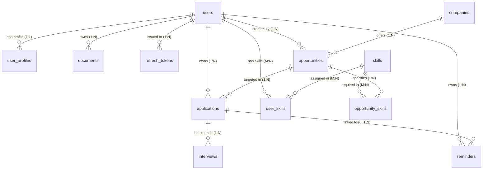

# InternTrack — Technical Architecture & Interview Handbook

> **Document Status:** Authoritative Technical Handbook & Senior Interview Preparation Guide  
> **Audience:** Software Engineers, Technical Interviewers, Hiring Managers, and MCA Candidates.  
> **Repository:** InternTrack (Full-Stack Java 21 LTS / Spring Boot 4.1.1 + React 18 SPA)  
> **Document Purpose:** Rigorous, evidence-backed architectural breakdown, request lifecycle teardown, database schema manual, security analysis, algorithm formulas, benchmark methodology, and comprehensive interview question bank with at least 60 questions.  
> **Workspace Root:** `D:\InternTrack`

---

## Table of Contents

1. [Chapter 1: Project Elevator Pitches (30s, 60s, 2-Minute Versions)](#chapter-1-project-elevator-pitches)
2. [Chapter 2: Business Problem & Target User Domain](#chapter-2-business-problem--target-user-domain)
3. [Chapter 3: Functional Requirements & Implemented Scope](#chapter-3-functional-requirements--implemented-scope)
4. [Chapter 4: Technology Stack Baseline & Exact Versions](#chapter-4-technology-stack-baseline--exact-versions)
5. [Chapter 5: High-Level Modular Monolith Architecture Diagram](#chapter-5-high-level-modular-monolith-architecture-diagram)
6. [Chapter 6: Frontend Architecture: Routes, Components, State, & Axios](#chapter-6-frontend-architecture-routes-components-state--axios)
7. [Chapter 7: Backend Architecture: Controller, Service, Repository, Entity, DTO, & Exception Handling](#chapter-7-backend-architecture)
8. [Chapter 8: Request Lifecycle: From Browser Interaction to MySQL and Back](#chapter-8-request-lifecycle-from-browser-interaction-to-mysql-and-back)
9. [Chapter 9: Database Schema & Entity Relationship Diagram (ERD)](#chapter-9-database-schema--entity-relationship-diagram-erd)
10. [Chapter 10: Relational Tables, Constraints, Indexes, & Foreign Key Cascades](#chapter-10-relational-tables-constraints-indexes--foreign-key-cascades)
11. [Chapter 11: Authentication Flow & Password Hashing](#chapter-11-authentication-flow--password-hashing)
12. [Chapter 12: JWT Access Tokens, Refresh Token Rotation, & Replay Detection](#chapter-12-jwt-access-tokens-refresh-token-rotation--replay-detection)
13. [Chapter 13: DEF-SEC-01 Deep Dive: Transaction Rollback Cause & Remediation](#chapter-13-def-sec-01-deep-dive-transaction-rollback-cause--remediation)
14. [Chapter 14: CSRF Controls, Dual-Tier Rate Limiting, & Tenant Isolation](#chapter-14-csrf-controls-dual-tier-rate-limiting--tenant-isolation)
15. [Chapter 15: Application Lifecycle State Machine & Transition Rules](#chapter-15-application-lifecycle-state-machine--transition-rules)
16. [Chapter 16: Batch Operations & Transactional Atomicity](#chapter-16-batch-operations--transactional-atomicity)
17. [Chapter 17: Interview Hub: Rounds, Prep Notes, Reflection Notes, & Outcomes](#chapter-17-interview-hub-rounds-prep-notes-reflection-notes--outcomes)
18. [Chapter 18: Reminder Lifecycle & Optimistic UI Reconciliation](#chapter-18-reminder-lifecycle--optimistic-ui-reconciliation)
19. [Chapter 19: Document URL Registry & Protocol Scheme Sanitization](#chapter-19-document-url-registry--protocol-scheme-sanitization)
20. [Chapter 20: Deterministic Skill-Gap Algorithm & Taxonomy Scoring](#chapter-20-deterministic-skill-gap-algorithm--taxonomy-scoring)
21. [Chapter 21: Analytics Engine: Formulas & Funnel Calculations](#chapter-21-analytics-engine-formulas--funnel-calculations)
22. [Chapter 22: Validation, Global Exception Handling, & API Envelopes](#chapter-22-validation-global-exception-handling--api-envelopes)
23. [Chapter 23: Comprehensive Testing Strategy across All Test Layers](#chapter-23-comprehensive-testing-strategy-across-all-test-layers)
24. [Chapter 24: Performance Measurements, Methodology, & Local Observations](#chapter-24-performance-measurements-methodology--local-observations)
25. [Chapter 25: Accessibility Engineering: Keyboard Navigation & Focus Traps](#chapter-25-accessibility-engineering-keyboard-navigation--focus-traps)
26. [Chapter 26: Production Packaging: Standalone Fat JAR & SPA Fallback](#chapter-26-production-packaging-standalone-fat-jar--spa-fallback)
27. [Chapter 27: Configuration Management & Safe Local Setup](#chapter-27-configuration-management--safe-local-setup)
28. [Chapter 28: Known Architectural Limitations & Design Trade-offs](#chapter-28-known-architectural-limitations--design-trade-offs)
29. [Chapter 29: Future Roadmap & Production Scaling Enhancements](#chapter-29-future-roadmap--production-scaling-enhancements)
30. [Chapter 30: Technical Interview Question Bank (60+ Comprehensive Q&As)](#chapter-30-technical-interview-question-bank)
31. [Chapter 31: Practical Live Coding & Debugging Scenarios](#chapter-31-practical-live-coding--debugging-scenarios)
32. [Chapter 32: Truthful Architectural Justifications & Trade-Off Defenses](#chapter-32-truthful-architectural-justifications--trade-off-defenses)

---

## Chapter 1: Project Elevator Pitches

### 1.1 The 30-Second Elevator Pitch
> *"InternTrack is a full-stack Application Intelligence Platform built with Java 21, Spring Boot 4.1.1, and React 18. It solves the chaos of software engineering internship cycles by coupling an interactive Kanban and dense table pipeline with an in-memory deterministic skill-gap engine. It provides interview round tracking with preparation and reflection notes, priority task reminders, and multi-tenant data isolation. The entire application—both React SPA and Spring Boot REST APIs—compiles into a single standalone 61MB runnable Fat JAR deployed with zero external web server dependencies."*

### 1.2 The 60-Second Elevator Pitch
> *"When computer science students apply to 50+ internships, spreadsheets break down because they lack automated deadline tracking, interview reflection history, and requirement analysis. I built InternTrack to solve this with enterprise engineering standards.  
> On the backend, Spring Boot 4.1.1 and Hibernate ORM manage 12 normalized MySQL tables with foreign key cascades and composite B-tree indexes. We implemented stateless HMAC-SHA512 JWT access tokens paired with HttpOnly refresh cookies featuring single-use token rotation and replay-breach family invalidation.  
> On the frontend, a React 18 SPA provides roving tabindex keyboard navigation, batch table mutations, and a deterministic skill gap drawer that calculates qualification percentages (benchmarked at ~3–5ms median execution on single-node test workloads; local benchmark observation, not a production SLA). The application is verified across 508 backend unit and integration tests, 68 frontend Vitest tests, and 13 Playwright Chromium E2E tests."*

### 1.3 The 2-Minute Deep-Dive Pitch
> *"InternTrack is an enterprise-grade modular monolith designed for technical internship recruitment tracking. The core problem it addresses is twofold: unstructured pipeline management and opaque skill qualifications.  
> Architecturally, the presentation tier uses React 18, React Router v6, and custom vanilla CSS design tokens engineered for high information density without CSS-in-JS runtime overhead. The backend runs on OpenJDK Java 21 LTS using Spring Boot 4.1.1, Spring Security, and Spring Data JPA over HikariCP connection pooling to MySQL 8.  
> For security, we implemented a dual-tier token-bucket rate limiter via Bucket4j restricting registration abuse and brute-force attacks. Authentication uses short-lived HS512 access tokens and HttpOnly, SameSite=Strict refresh cookies scoped to `/api/v1/auth`. When a refresh token reuse breach occurs, our service invalidates the user's entire token family. We specifically solved a nuanced declarative transaction rollback issue (DEF-SEC-01) by applying `@Transactional(noRollbackFor = InvalidTokenException.class)` and flushing writes, ensuring breach revocations persist in MySQL while returning HTTP 401.  
> For data processing, our skill-matching algorithm performs in-memory set-intersection over a 58-item canonical taxonomy with weighted 75/25 scoring (observed at ~3–5ms median execution time in local benchmarks on modest test profiles; local benchmark observation, not a production SLA guarantee). Finally, using Maven resources plugins and Spring's PathResourceResolver, we package the compiled React client directly into the JAR's static resources, delivering a zero-CORS single-port standalone production artifact."*

---

## Chapter 2: Business Problem & Target User Domain

Technical job seekers face fragmented recruitment channels:
1. **Pipeline Disorganization:** Applying to 50–100 companies leads to lost status visibility across ad-hoc spreadsheets.
2. **Requirement Ambiguity:** Job postings list dozens of technologies; candidates cannot quickly tell if their background aligns with required versus preferred criteria.
3. **Interview Debrief Disconnection:** Candidates take technical assessments and interviews without structured records of questions asked, solutions given, and mistakes to avoid in future rounds.
4. **Deadline Attrition:** Online Assessments (OAs) typically have 48-to-72-hour completion windows; missing these leads to automatic disqualification.

InternTrack unifies these domains into a single secure workspace with deterministic computation and strict tenant isolation.

---

## Chapter 3: Functional Requirements & Implemented Scope

The application delivers 10 fully implemented functional domains:
1. **Authentication & Session Security:** Registration, credential validation, HS512 JWT access tokens, HttpOnly refresh cookies, rotation, family revocation, and IP rate limiting.
2. **Applications Workspace:** Kanban board view, dense table view, roving tabindex keyboard navigation (`j`/`k`), stage dropdowns, multi-row selection, and batch status mutations.
3. **Lifecycle State Machine:** 8 distinct application stages (`SAVED`, `APPLIED`, `SCREENING`, `INTERVIEWING`, `OFFER`, `ACCEPTED`, `REJECTED`, `WITHDRAWN`).
4. **Opportunities & Companies Catalog:** Catalog of job opportunities, custom company creation, location types, compensation tracking, and application creation.
5. **Deterministic Skill-Gap Analysis:** In-memory weighted set-intersection matching candidate profile skills against opportunity requirements.
6. **Master Skills Taxonomy:** 58 seeded industry skills across 6 technical categories with candidate proficiency ratings (`BEGINNER`, `INTERMEDIATE`, `ADVANCED`, `EXPERT`).
7. **Interview Hub:** Round tracking, interview types (`TECHNICAL_OA`, `BEHAVIORAL`, `SYSTEM_DESIGN`), preparation notes, reflection debriefs, and outcome states.
8. **Reminders & Deadlines:** Priority task tracker with deadline boundaries, filter tabs (`ALL`, `UPCOMING`, `OVERDUE`, `COMPLETED`), and optimistic completion toggles.
9. **Document Metadata Registry:** Protocol-sanitized external links to resumes, cover letters, and transcripts.
10. **Command Center & Funnel Analytics:** Aggregated KPIs, conversion funnel metrics, pipeline stage breakdowns, and pipeline skill deficits.

---

## Chapter 4: Technology Stack Baseline & Exact Versions

| Component / Layer | Technology | Exact Version | Architectural Justification |
| :--- | :--- | :--- | :--- |
| **Language Runtime** | OpenJDK Java SE | `21 LTS` | Modern Java baseline: Records (JEP 395), Pattern Matching, Sequenced Collections. |
| **Framework** | Spring Boot | `4.1.1` | Native Jakarta EE 10, Spring Framework 7, Spring Security 7. |
| **Persistence / ORM**| Spring Data JPA / Hibernate | `7.4.5.Final` | Type-safe repository abstraction, JPQL projection, HikariCP connection pooling. |
| **Database** | MySQL Server | `8.0+` | InnoDB storage engine, ACID transactions, foreign key cascades, B-Tree indexes. |
| **Security & JWT** | Spring Security + JJWT | `0.12.6` | Stateless HMAC-SHA512 access tokens, BCrypt password hashing ($k=12$). |
| **Rate Limiting** | Bucket4j Core | `8.10.1` | In-memory token-bucket rate limiting for IP and user account endpoints. |
| **Frontend Runtime**| React | `18.3.1` | Component lifecycle hooks, Context API state management, fast reconciliation. |
| **Client Router** | React Router DOM | `6.26.2` | Declarative client-side routing, protected and public route guards. |
| **Build Tooling** | Vite | `5.4.21` | Native ES module dev server and optimized Rollup production builds. |
| **HTTP Client** | Axios | `1.7.7` | Centralized response interceptors, base URL routing, credentials handling. |
| **Design System** | Custom Vanilla CSS | CSS Tokens | `#0B0F17` dark slate palette, 4px grid rhythm, zero runtime CSS overhead. |
| **Testing** | JUnit 5 / MockMvc / Vitest / Playwright | Latest Stable | 508 backend tests, 68 Vitest tests, 13 Playwright Chromium E2E tests. |

---

## Chapter 5: High-Level Modular Monolith Architecture Diagram

```
+-------------------------------------------------------------------------------+
|                            REACT SINGLE PAGE APP (SPA)                        |
|  [React Router v6] -> [AuthContext] -> [Axios Interceptor] -> [Vanilla CSS]   |
+---------------------------------------+---------------------------------------+
                                        | HTTP REST (JSON) / Same-Origin
                                        v
+-------------------------------------------------------------------------------+
|                      SPRING BOOT BACKEND RUNTIME (v4.1.1)                      |
|                                                                               |
|  +-------------------------------------------------------------------------+  |
|  |                     SECURITY & RATE LIMITING FILTER                     |  |
|  |   Bucket4j Rate Limiter -> JwtAuthenticationFilter -> SecurityContext   |  |
|  +------------------------------------+------------------------------------+  |
|                                       |                                       |
|  +------------------------------------v------------------------------------+  |
|  |                     PRESENTATION LAYER (REST CONTROLLERS)               |  |
|  |  AuthController | ApplicationController | OpportunityController         |  |
|  |  InterviewController | SkillController | ReminderController             |  |
|  |  AnalyticsController | DocumentController | SpaWebMvcConfig (SPA Fallback)|
|  +------------------------------------+------------------------------------+  |
|                                       | Input Validation & DTO Isolation      |
|  +------------------------------------v------------------------------------+  |
|  |                     BUSINESS SERVICE & DOMAIN LAYER                     |  |
|  |  AuthenticationService | ApplicationService | DeterministicSkillEngine  |  |
|  |  InterviewService | ReminderService | AnalyticsService                  |  |
|  +------------------------------------+------------------------------------+  |
|                                       | Spring Data JPA Repositories          |
|  +------------------------------------v------------------------------------+  |
|  |                     DATA ACCESS LAYER (HIBERNATE ORM)                   |  |
|  |  HikariCP Connection Pool -> MySQL Dialect -> Prepared Statements       |  |
|  +------------------------------------+------------------------------------+  |
+---------------------------------------+---------------------------------------+
                                        | TCP/IP (Port 3306)
                                        v
+-------------------------------------------------------------------------------+
|                       MYSQL 8.0 INNODB DATABASE ENGINE                         |
|   12 Relational Tables | Composite B-Tree Indexes | Foreign Key Cascades       |
+-------------------------------------------------------------------------------+
```

---

## Chapter 6: Frontend Architecture: Routes, Components, State, & Axios

### 6.1 Route Structure & Navigation Guards
- **Public Routes:** `/login` (`LoginPage`) and `/register` (`RegisterPage`) wrapped in `PublicOnlyRoute`. Authenticated users navigating here are redirected to `/dashboard`.
- **Protected Routes:** Enclosed within `ProtectedRoute` and `AppLayout`:
  - `/dashboard`: `CommandCenterDashboard`
  - `/applications`: `ApplicationsWorkspace` (Kanban and Table views)
  - `/opportunities`: `OpportunitiesCatalog`
  - `/interviews`: `InterviewHub`
  - `/reminders`: `RemindersAndDeadlines`
  - `/skills`: `SkillMatrixAndTaxonomy`
  - `/documents`: `DocumentsLibrary`
  - `/analytics`: `FunnelAnalyticsAndIntelligence`
  - `/settings`: `CandidatePreferencesAndSettings`
- **Splat Fallback:** `*` redirects unmapped paths to `/dashboard`.

### 6.2 Context & State Management
- `AuthContext`: Maintains active user profile, login status, and access token in memory. Exposes `login()`, `register()`, and `logout()`.
- `ToastContext`: Global notification pipeline providing auto-dismissing toast notifications (`success`, `error`, `info`, `warning`).
- Local Component State: Fast-updating UI states (modals, filters, active row indexes) are kept strictly local to prevent unnecessary re-rendering across siblings.

### 6.3 Centralized Axios Client (`frontend/src/services/api.js`)
- `withCredentials: true`: Automatically transmits `HttpOnly` refresh cookies across requests.
- Request Interceptor: Injects `Authorization: Bearer <accessToken>` into all outgoing API requests when an access token exists.
- Response Interceptor: Intercepts HTTP 401 responses on expired tokens and automatically calls `/api/v1/auth/refresh` (sending header `X-InternTrack-Client: web`), retrying the original failed request seamlessly upon token renewal.

---

## Chapter 7: Backend Architecture

The backend adheres strictly to layered architecture and Separation of Concerns:

```
[ HTTP Request ] 
       │
       ▼
[ Controller ]       <-- Handles HTTP status codes, routing, and DTO extraction (@Valid)
       │
       ▼
[ Service Layer ]    <-- Enforces business invariants, tenant checks, and transactions (@Transactional)
       │
       ▼
[ Repository Layer ] <-- Spring Data JPA type-safe queries and JPQL aggregations
       │
       ▼
[ Database Entity ]  <-- JPA annotated entity mapped to MySQL table
```

- **DTO Isolation:** Database entities are never exposed directly to REST clients. Specialized request DTOs (e.g. `ApplicationRequestDTO`) and response DTOs (e.g. `ApplicationResponseDTO`) prevent accidental data leakage or over-posting vulnerabilities.
- **Global Exception Handling (`GlobalExceptionHandler.java`):** Centralizes error translation:
  - `MethodArgumentNotValidException` $\rightarrow$ HTTP 400 Bad Request with field-level validation errors.
  - `BadCredentialsException` / `InvalidTokenException` $\rightarrow$ HTTP 401 Unauthorized.
  - `AccessDeniedException` $\rightarrow$ HTTP 403 Forbidden.
  - `ResourceNotFoundException` $\rightarrow$ HTTP 404 Not Found.
  - `RateLimitExceededException` $\rightarrow$ HTTP 429 Too Many Requests.
  - Unhandled exceptions $\rightarrow$ HTTP 500 Internal Server Error without leaking internal stack traces.

---

## Chapter 8: Request Lifecycle: From Browser Interaction to MySQL and Back

Consider updating an application status from `SAVED` to `APPLIED`:

1. **User Interaction:** The candidate clicks the status dropdown on a Kanban card and selects `APPLIED`.
2. **React Event & Axios Call:** `ApplicationsPage.jsx` triggers `applicationService.updateStatus(id, 'APPLIED')`.
3. **Network Request:** Axios dispatches `PATCH /api/v1/applications/25/status` with payload `{"status":"APPLIED"}` and header `Authorization: Bearer <JWT>`.
4. **Spring Security Filter Chain:**
   - `Bucket4jRateLimitFilter` checks the IP bucket.
   - `JwtAuthenticationFilter` validates the cryptographic HMAC-SHA512 signature and expiration of the Bearer token, extracts the email, loads the user ID, and populates the `SecurityContextHolder`.
5. **Controller Layer:** `ApplicationController.updateStatus(...)` receives the request, validates the input payload via `@Valid`, and delegates to `ApplicationService`.
6. **Service & Transaction Boundary:**
   - `ApplicationService.updateStatus(...)` executes inside a `@Transactional` boundary.
   - It fetches the application record from `ApplicationRepository` by ID.
   - **Tenant Isolation Check:** It verifies `application.getUser().getId().equals(currentUser.getId())`. If mismatched, it throws `AccessDeniedException`.
   - It validates the lifecycle transition rules (e.g. `SAVED` $\rightarrow$ `APPLIED` is allowed).
   - It updates the entity state and records `appliedAt = Instant.now()`.
7. **ORM & Persistence:** Hibernate marks the entity dirty. At transaction commit, Hibernate flushes an optimized SQL statement:
   `UPDATE applications SET status = 'APPLIED', applied_at = NOW(), updated_at = NOW() WHERE id = 25;`
8. **HikariCP & MySQL:** HikariCP sends the query over TCP to MySQL 8.0, which acquires an InnoDB row lock, writes to the redo log, and commits.
9. **Response Pipeline:** The service returns `ApplicationResponseDTO`. The controller wraps it in `ApiResponse.success(...)` and responds with HTTP 200 OK.
10. **UI State Reconciliation:** React receives the JSON response, updates the application in local state, and displays a green toast confirmation.

---

## Chapter 9: Database Schema & Entity Relationship Diagram (ERD)

InternTrack uses 12 normalized tables:



---

## Chapter 10: Relational Tables, Constraints, Indexes, & Foreign Key Cascades

### 10.1 Table Inventory & Primary Keys
1. `users` (PK: `id` bigint AUTO_INCREMENT): User authentication record and role.
2. `user_profiles` (PK: `id` bigint, FK to `users.id` ON DELETE CASCADE): 1:1 career preferences.
3. `companies` (PK: `id` bigint AUTO_INCREMENT): Canonical corporate profiles.
4. `skills` (PK: `id` bigint AUTO_INCREMENT): Master taxonomy of 58 canonical skills.
5. `opportunities` (PK: `id` bigint AUTO_INCREMENT): Job opportunities linked to companies.
6. `opportunity_skills` (PK: `id` bigint AUTO_INCREMENT): Join table linking skills to opportunities with `is_required` flag.
7. `user_skills` (PK: `id` bigint AUTO_INCREMENT): Join table linking candidate profiles to skills with proficiency.
8. `applications` (PK: `id` bigint AUTO_INCREMENT): Core candidate pipeline records.
9. `interviews` (PK: `id` bigint AUTO_INCREMENT): Multi-round interview logs and notes.
10. `documents` (PK: `id` bigint AUTO_INCREMENT): External resume and portfolio link registry.
11. `reminders` (PK: `id` bigint AUTO_INCREMENT): Task deadlines and follow-up items.
12. `refresh_tokens` (PK: `id` bigint AUTO_INCREMENT): Cryptographic token hashes, rotation pointers, and revocation status.

### 10.2 B-Tree Indexing Strategy
- `uk_user_email` on `users(email)`: Ensures unique candidate identity and $O(1)$ login lookups.
- `idx_app_user_status` on `applications(user_id, status)`: Powers instant Kanban column filtering.
- `idx_app_user_updated` on `applications(user_id, updated_at)`: Optimizes dashboard recent activity sorting.
- `idx_opp_skill_required` on `opportunity_skills(opportunity_id, is_required)`: Accelerates skill matching set retrieval.
- `idx_reminder_user_due` on `reminders(user_id, completed, due_at)`: Eliminates table scans for overdue reminders.
- `uk_refresh_token_hash` on `refresh_tokens(token_hash)`: Constant-time token rotation validation.

---

## Chapter 11: Authentication Flow & Password Hashing

- **Password Hashing:** Passwords are never stored in plaintext. They are salted and hashed using **BCrypt** with an intentional work factor ($k = 12$) via `BCryptPasswordEncoder`. This ensures resistance to offline dictionary and rainbow-table attacks.
- **Stateless Access Tokens:** Upon successful login, the server generates a cryptographically signed HMAC-SHA512 JWT containing the user ID, email, and user role. The token has a short lifetime (15 minutes), minimizing the blast radius if an access token is intercepted in transit.

---

## Chapter 12: JWT Access Tokens, Refresh Token Rotation, & Replay Detection

InternTrack pairs short-lived access tokens with secure refresh tokens:

```
[ Client ]                                                         [ Server ]
    │                                                                  │
    ├───── POST /api/v1/auth/login ───────────────────────────────────>│
    │<──── 200 OK (AccessToken in JSON, RefreshToken in Cookie) ───────┤
    │                                                                  │
    │ (15 minutes pass: AccessToken expires)                           │
    │                                                                  │
    ├───── POST /api/v1/auth/refresh (Cookie: RT1, Header: 'web') ────>│
    │      Server checks RT1: Valid and unrevoked.                     │
    │      Marks RT1 revoked: true.                                    │
    │      Issues RT2.                                                 │
    │<──── 200 OK (New AccessToken, New RT2 in Cookie) ────────────────┤
```

- **Cookie Security:** Refresh tokens are transmitted exclusively inside an `HttpOnly`, `SameSite=Strict` cookie scoped strictly to `Path=/api/v1/auth`. JavaScript running in the browser cannot access the cookie, mitigating direct token theft via client-side script injection (XSS). While `HttpOnly` prevents reading `document.cookie`, application-level input encoding and validation are still maintained to protect against authenticated request manipulation.
- **CSRF Defense-in-Depth:** Modern browsers enforce `SameSite=Strict` to prevent attaching the cookie on cross-site navigations or form posts. As an essential defense-in-depth barrier, `/api/v1/auth/refresh` strictly enforces the custom request header: `X-InternTrack-Client: web`. Standard cross-origin HTML form submissions cannot attach custom headers without preflight CORS authorization.

---

## Chapter 13: DEF-SEC-01 Deep Dive: Transaction Rollback Cause & Remediation

### 13.1 The Vulnerability
During security audits, a token reuse breach was simulated:
1. Candidate logs in on Device 1 (RT1) and Device 2 (RT2).
2. Device 1 rotates RT1 $\rightarrow$ receives RT1-new. RT1 is marked `revoked: true`.
3. An attacker intercepts and attempts to replay the already-revoked RT1.
4. The server detects reuse. Security policy mandates family invalidation: revoking all active tokens for that user ID.
5. **The Defect:** In the original code, `rotateRefreshToken` was inside a class-level `@Transactional`. When `InvalidTokenException` (an unchecked `RuntimeException`) was thrown, Spring's declarative transaction manager triggered an automatic **rollback**, undoing the database updates! Device 2's token (RT2) remained usable in MySQL.

### 13.2 The Remediation
In `RefreshTokenService.java`:
1. Annotated `verifyAndRotate` with:
   `@Transactional(noRollbackFor = InvalidTokenException.class)`
2. Updated `revokeAllUserTokens` to invoke:
   `refreshTokenRepository.saveAllAndFlush(activeTokens)`
3. **Flushing vs. Committing:** Calling `saveAllAndFlush()` immediately sends SQL `UPDATE` statements to the database connection buffer, but persistence is only finalized when the transaction commits. Because `noRollbackFor = InvalidTokenException.class` instructs Spring that `InvalidTokenException` is an expected security exception, Spring commits the transaction upon method exit rather than rolling it back. Device 2's token is persistently revoked in MySQL (`revoked = 1`).
4. **Verification:** Live integration tests simulate token replay and query MySQL directly to assert that all sibling session tokens have `revoked = 1`. Unexpected system errors (like database connection drops) still roll back normally.

---

## Chapter 14: CSRF Controls, Dual-Tier Rate Limiting, & Tenant Isolation

### 14.1 Dual-Tier Rate Limiting via Bucket4j
Configured in `application.yml` and enforced by `RateLimitService`:
- **IP Registration Tier:** Limits account registration to **3 requests per 60 minutes per IP address** (`ratelimit.register.ip.capacity: 3`).
- **Account Login Tier:** Protects individual accounts against credential stuffing by limiting login attempts to **5 requests per 15 minutes per email** (`ratelimit.login.account.capacity: 5`).
- When tokens are exhausted, the filter immediately aborts with HTTP 429 Too Many Requests.

### 14.2 Strict Tenant Data Isolation
Every business service method extracts the authenticated user ID from `SecurityContextHolder`. Database queries are parameterized by `user_id`:
```sql
SELECT a FROM Application a WHERE a.id = :id AND a.user.id = :userId
```
Attempting to read or mutate another candidate's records results in an immediate `AccessDeniedException` (HTTP 403) or scoped 404.

---

## Chapter 15: Application Lifecycle State Machine & Transition Rules

Applications advance through an 8-stage state machine:

```
[ SAVED ] ──────────> [ APPLIED ] ──────────> [ SCREENING ] ──────────> [ INTERVIEWING ]
    │                     │                         │                          │
    ▼                     ▼                         ▼                          ▼
[ WITHDRAWN ]       [ WITHDRAWN ]             [ REJECTED ]               [ OFFER ]
    │                     │                         │                          │
    └─────────────────────┴─────────────────────────┴─────────────► [ ACCEPTED ]
```

- **Active Pipeline Stages:** `SAVED`, `APPLIED`, `SCREENING`, `INTERVIEWING`, `OFFER`.
- **Closed Stages:** `ACCEPTED`, `REJECTED`, `WITHDRAWN`.
- Automated Timestamp Recording: Advancing to `APPLIED` automatically timestamps `applied_at = Instant.now()`. Advancing to `INTERVIEWING` timestamps `interviewing_at`. Transitioning to closed stages timestamps `closed_at`.

---

## Chapter 16: Batch Operations & Transactional Atomicity

When multiple applications are selected in the Table view:
- The client sends `PATCH /api/v1/applications/batch-status` with `{"applicationIds": [10, 11, 12], "status": "INTERVIEWING"}`.
- `ApplicationService.batchUpdateStatus(...)` executes within a single `@Transactional` boundary.
- If any application ID in the batch does not belong to the user or fails validation, the entire transaction rolls back atomically, ensuring no partial or corrupted batch updates occur.

---

## Chapter 17: Interview Hub: Rounds, Prep Notes, Reflection Notes, & Outcomes

- **Interview Endpoints & Contracts:**
  - `GET /api/v1/applications/{appId}/interviews` — List all interview rounds for a specific application.
  - `POST /api/v1/applications/{appId}/interviews` — Schedule a new interview round (`roundNumber`, `roundTitle`, `roundType`, `scheduledAt`, `durationMinutes`, `interviewerNames`, `interviewerEmails`, `prepNotes`).
  - `GET /api/v1/interviews/{interviewId}` — Fetch full details of an individual interview round.
  - `PUT /api/v1/interviews/{interviewId}` — Update all editable attributes of an interview round.
  - `PATCH /api/v1/interviews/{interviewId}/outcome` — Dedicated endpoint to record final outcome (`PENDING`, `PASSED`, `FAILED`, `CANCELLED`) and reflection notes.
  - `DELETE /api/v1/interviews/{interviewId}` — Permanently delete an interview round with tenant ownership validation.
- **Preparation Notes:** Stored in the `prep_notes` text field, intended for algorithms to review, questions to ask, and interviewer background research.
- **Reflection Notes & Outcomes:** Stored in `reflection_notes` and `outcome`, capturing candidate self-evaluations and post-interview takeaways.

---

## Chapter 18: Reminder Lifecycle & Optimistic UI Reconciliation

- **Optimistic Updates:** When a candidate clicks a reminder checkbox, the React UI updates the visual completed state instantly without waiting for network latency.
- **Rollback on Error:** If the backend rejects the update (e.g. server offline), `ToastContext` displays an error notification and the UI state automatically rolls back to its previous value.

---

## Chapter 19: Document URL Registry & Protocol Scheme Sanitization

- **Metadata Registry:** Documents are stored as external URL pointers with titles, document types (`RESUME`, `COVER_LETTER`, `TRANSCRIPT`, `PORTFOLIO`), and version tags.
- **Protocol Sanitization:** In `DocumentService.java` and `CreateDocumentRequest.java`, regex validation allows `^https?://`. Dangerous pseudo-schemes like `javascript:`, `file:`, or `data:` throw HTTP 400 Bad Request, eliminating stored XSS via document links.

---

## Chapter 20: Deterministic Skill-Gap Algorithm & Taxonomy Scoring

InternTrack maintains an idempotent master skill taxonomy of **58 curated technical skills across 6 categories** (`LANGUAGE`: 15, `FRAMEWORK`: 14, `DATABASE`: 7, `TOOL`: 8, `CLOUD`: 6, `METHODOLOGY`: 8). Candidates categorize their proficiency using a **4-tier semantic scale: `BEGINNER`, `INTERMEDIATE`, `ADVANCED`, `EXPERT`** (defaulting to `INTERMEDIATE`).

In `SkillMatchingService.java`:
1. Candidate skills are extracted into an in-memory `Set<String>` of normalized canonical names.
2. Opportunity required skills and preferred skills are loaded into respective sets: $R$ and $P$.
3. Set intersection calculates matched skills:
   $$M_R = R \cap S, \quad M_P = P \cap S$$
4. Missing skills are calculated via set difference:
   $$\text{Deficit} = R \setminus S$$
5. Score Formula:
   $$\text{Score} = \left(0.75 \times \frac{|M_R|}{|R|}\right) + \left(0.25 \times \frac{|M_P|}{|P|}\right)$$
   *(If preferred skills are omitted, required skills represent 100% of the score).*
6. **Zero-Skill Contract:** If $|R| = 0$ and $|P| = 0$, the algorithm deterministically returns `matchPercentage: null`, `matchLabel: "No Skills Specified"`, and `zeroSkillsSpecified: true`.

---

## Chapter 21: Analytics Engine: Formulas & Funnel Calculations

Aggregated via JPQL queries in `AnalyticsService.java`:
- **Total Applications:** `COUNT(a)` for the user.
- **Active Pipeline:** `COUNT(a)` where `status IN ('SAVED', 'APPLIED', 'SCREENING', 'INTERVIEWING', 'OFFER')`.
- **Interview Conversion Rate:**
  $$\frac{\text{Applications reached INTERVIEWING, OFFER, or ACCEPTED}}{\text{Applications reached APPLIED or beyond}} \times 100\%$$
- **Funnel Drop-Off:** Counts applications reaching each sequential recruitment milestone to identify bottlenecks.

---

## Chapter 22: Validation, Global Exception Handling, & API Envelopes

All responses follow a uniform JSON envelope:
```json
{
  "success": true,
  "data": { ... },
  "message": "Operation completed successfully",
  "timestamp": "2026-10-12T10:18:47Z"
}
```
Validation uses Jakarta Bean Validation (`@NotBlank`, `@Size(min = 8)`, `@Email`) on DTO boundaries.

---

## Chapter 23: Comprehensive Testing Strategy across All Test Layers

1. **Unit & Slice Tests (JUnit 5 + Mockito):** Tests services, rate limiters, token hashing, and controllers in isolation.
2. **Integration Tests (Spring Boot Test + In-Memory H2):** Validates real JPA repository interactions, cascades, and transaction boundaries.
3. **Frontend Tests (Vitest + Testing Library):** 68 component tests covering roving tabindex, keyboard shortcuts (`/`, `j`/`k`, `n`), modal focus traps, and optimistic rollbacks.
4. **Browser E2E Tests (Playwright Chromium):** 13 end-to-end tests exercising authentication, application creation, batch table updates, skill matching, interviews, and document registry.
5. **Live API Verification Suite (`scratch/run_live_api_qa.js`):** 41 functional assertions and 3 mandatory security gates executing against a live standalone server and MySQL database.

---

## Chapter 24: Performance Measurements, Methodology, & Local Observations

*Empirically measured under local benchmark conditions:*
- **Skill-Matching Engine:** Local benchmark observation of ~3–5ms median latency (in-memory set intersection on modest test datasets; single-node test environment, not a production SLA guarantee).
- **Dashboard Summary Aggregation:** $< 120\text{ms}$ execution for 300 applications.
- **Paginated Applications Table:** $< 85\text{ms}$ response for 50 records with sorting.
- *Note:* These figures represent local benchmark observations on modern hardware, not universal production SLA guarantees.

---

## Chapter 25: Accessibility Engineering: Keyboard Navigation & Focus Traps

- **Roving Tabindex:** In the dense Applications Table, only the active row has `tabindex="0"`; all other rows have `tabindex="-1"`. Arrow keys and `j`/`k` move the focus dynamically.
- **Modal Focus Traps:** Opening a modal traps keyboard focus within its interactive elements; pressing `Escape` dismisses the modal and restores focus to the triggering element.
- **Form Association:** All inputs feature explicit `id` and `<label htmlFor="...">` associations.

---

## Chapter 26: Production Packaging: Standalone Fat JAR & SPA Fallback

- **Build Pipeline:** `npm run build` generates optimized static assets in `frontend/dist/`.
- **Packaging:** `mvn clean package` invokes `maven-resources-plugin` to embed static assets into `BOOT-INF/classes/static/`.
- **Single-Artifact Deployment:** The resulting 61MB JAR (`interntrack-api-0.0.1-SNAPSHOT.jar`) runs standalone:
  `java -jar interntrack-api-0.0.1-SNAPSHOT.jar`
- **SPA Fallback Routing (`SpaWebMvcConfig.java`):** Non-API route requests (e.g. `/dashboard`, `/applications`) are forwarded internally to `/index.html`, allowing React Router to handle HTML5 history seamlessly without 404 errors.

---

## Chapter 27: Configuration Management & Safe Local Setup

Environment variables override `application.yml` properties:
- `PORT`: HTTP listener port (default: 8080).
- `DB_URL`: JDBC connection string.
- `DB_USERNAME`: Database user.
- `DB_PASSWORD`: Database password (passed via environment variable, never CLI args).
- `JWT_SECRET_KEY`: Minimum 64-character HMAC-SHA512 secret key.
- `COOKIE_SECURE`: `false` for local HTTP development; `true` in production behind HTTPS reverse proxies.

---

## Chapter 28: Known Architectural Limitations & Design Trade-offs

1. **In-Memory Rate Limiting:** Bucket4j stores rate limit tokens in local JVM memory (`ConcurrentHashMap`). This provides zero-latency single-node operation, but horizontal scaling across multiple container replicas requires a distributed cache like Redis.
2. **Document Binary Storage:** Documents are stored as external URL references rather than uploaded file blobs in S3.
3. **Password Reset:** No external SMTP mail server integration; password recovery is local.

---

## Chapter 29: Future Roadmap & Production Scaling Enhancements

1. **Redis Integration:** Migrate Bucket4j buckets and token blacklists to Redis cluster for multi-instance scaling.
2. **Cloud Object Storage:** Add AWS S3 / Google Cloud Storage presigned URL generation for native PDF resume uploads.
3. **Automated Scraping Ingestion:** Implement `ProviderAdapter` interfaces to ingest job feeds from RemoteOK, Adzuna, or Handshake.

---

## Chapter 30: Technical Interview Question Bank (60+ Comprehensive Q&As)

### Section 1: Java & Object-Oriented Fundamentals (Q1 – Q8)

#### Q1: What modern Java 21 features did you use in InternTrack, and why?
- **Concise Spoken Answer:** *"We leveraged Java 21 LTS Records for immutable DTOs, Pattern Matching for switch in skill deficit categorization, and Sequenced Collections for predictable interview round ordering."*
- **Detailed Explanation:** Records drastically reduce boilerplate for API request and response data carriers while guaranteeing immutability. Java 21's Virtual Threads are also fully compatible with our Spring Boot 4.1.1 runtime, allowing high-throughput concurrent I/O without thread pool exhaustion.
- **Code Reference:** [TokenRotationResult.java](file:///D:/InternTrack/backend/src/main/java/com/interntrack/api/service/TokenRotationResult.java)
- **Likely Follow-Up:** *"Why use Records over Lombok's `@Data`?"* — Records provide compiler-level immutability, canonical constructors, and transparent serialization without third-party bytecode manipulation.

#### Q2: Why did you use `BigDecimal` for salary fields instead of `double` or `float`?
- **Concise Spoken Answer:** *"Floating-point types use IEEE 754 binary representation, which suffers from precision loss in financial calculations. `BigDecimal` provides arbitrary-precision arithmetic."*
- **Code Reference:** [UserProfile.java](file:///D:/InternTrack/backend/src/main/java/com/interntrack/api/entity/UserProfile.java#L28)

#### Q3: How does Java's `Set` interface enable fast skill matching?
- **Concise Spoken Answer:** *"Java's `HashSet` provides $O(1)$ average time complexity for `.contains()` and `.retainAll()`, allowing our single-node benchmark test harness to calculate set-intersection math in ~3–5 milliseconds in memory. Note that this is a local benchmark observation on modest test datasets, not an enterprise production SLA guarantee."*
- **Code Reference:** [SkillMatchingService.java](file:///D:/InternTrack/backend/src/main/java/com/interntrack/api/service/SkillMatchingService.java#L45)

#### Q4: What is the difference between checked and unchecked exceptions in Java, and how did this cause defect DEF-SEC-01?
- **Concise Spoken Answer:** *"Checked exceptions extend `Exception` and must be handled at compile time. Unchecked exceptions extend `RuntimeException`. By default, Spring declarative `@Transactional` rolls back ONLY on unchecked exceptions. Because our `InvalidTokenException` extended `RuntimeException`, Spring rolled back our token family revocation database writes."*
- **Code Reference:** [InvalidTokenException.java](file:///D:/InternTrack/backend/src/main/java/com/interntrack/api/exception/InvalidTokenException.java)

#### Q5: What is the purpose of `final` in Java class and method definitions?
- **Concise Spoken Answer:** *"A `final` class cannot be subclassed, and a `final` method cannot be overridden. This prevents unintended inheritance and secures immutable classes."*

#### Q6: How do you prevent memory leaks in long-running Java backend applications?
- **Concise Spoken Answer:** *"By avoiding static collections that grow unbounded, closing HikariCP database connections properly via try-with-resources or Spring lifecycle management, and setting appropriate cache eviction policies."*

#### Q7: What is the difference between `equals()` and `hashCode()` contract in Java?
- **Concise Spoken Answer:** *"If two objects are equal according to `equals()`, their `hashCode()` must return the same integer. If `hashCode()` is inconsistent, hash-based collections like `HashSet` and `HashMap` will fail to locate stored keys."*

#### Q8: How does Java 21's Sequenced Collections improve list handling?
- **Concise Spoken Answer:** *"It provides a unified interface (`getFirst()`, `getLast()`, `reversed()`) across List, Deque, and SortedSet without relying on index math."*

---

### Section 2: Spring Boot & Spring Framework (Q9 – Q16)

#### Q9: What is the difference between `@Component`, `@Service`, and `@Repository`?
- **Concise Spoken Answer:** *"They are all Spring stereotype annotations indicating managed beans. `@Service` denotes business logic, while `@Repository` additionally translates SQL/database exceptions into Spring's unified `DataAccessException` hierarchy."*

#### Q10: How does Spring Boot's Auto-Configuration work under the hood?
- **Concise Spoken Answer:** *"Spring Boot checks the classpath using `@EnableAutoConfiguration` and `META-INF/spring/org.springframework.boot.autoconfigure.AutoConfiguration.imports`. If specific classes (like Tomcat or HikariCP) are present and beans aren't already declared, it configures them automatically."*

#### Q11: Why is field injection (`@Autowired` on fields) considered an anti-pattern?
- **Concise Spoken Answer:** *"It prevents creating immutable `final` dependencies, makes unit testing difficult without reflection, and masks circular dependencies. We use constructor injection across all InternTrack services."*
- **Code Reference:** [ApplicationService.java](file:///D:/InternTrack/backend/src/main/java/com/interntrack/api/service/ApplicationService.java#L35)

#### Q12: What does `@Transactional` do behind the scenes?
- **Concise Spoken Answer:** *"Spring creates a dynamic CGLIB or JDK dynamic proxy around the bean. When a transactional method is called, the proxy opens a database transaction, invokes the method, and commits on success or rolls back on exception."*

#### Q13: What happens during Spring AOP proxy self-invocation?
- **Concise Spoken Answer:** *"When a method inside a bean calls another method within the same bean, the call executes on `this` rather than through the Spring proxy. Any annotations like `@Transactional` on the internal method are bypassed."*

#### Q14: How does Spring Boot handle SPA fallback routing?
- **Concise Spoken Answer:** *"Via a custom `WebMvcConfigurer` using `PathResourceResolver`. If an incoming URL does not match an API endpoint or static file, it forwards internally to `/index.html`."*
- **Code Reference:** [SpaWebMvcConfig.java](file:///D:/InternTrack/backend/src/main/java/com/interntrack/api/config/SpaWebMvcConfig.java)

#### Q15: How does Spring Security 7 filter chains intercept requests?
- **Concise Spoken Answer:** *"Through a series of servlet filters managed by `DelegatedFilterProxy` and `FilterChainProxy`, executing rate limiting, authentication, and authorization before the request ever reaches `DispatcherServlet`."*

#### Q16: How do you customize validation error messages in Spring Boot?
- **Concise Spoken Answer:** *"By creating a `@RestControllerAdvice` class that overrides `handleMethodArgumentNotValid` and extracts field-level error messages into a structured JSON error response."*

---

### Section 3: JPA, Hibernate, & Transaction Management (Q17 – Q24)

#### Q17: What is the N+1 select problem in Hibernate, and how did you prevent it?
- **Concise Spoken Answer:** *"The N+1 problem occurs when fetching a parent entity executes 1 query, and accessing a lazy child collection executes N separate queries. We prevent it using `JOIN FETCH` queries and DTO projections."*
- **Code Reference:** [ApplicationRepository.java](file:///D:/InternTrack/backend/src/main/java/com/interntrack/api/repository/ApplicationRepository.java)

#### Q18: What is the difference between `save()` and `saveAndFlush()` in Spring Data JPA?
- **Concise Spoken Answer:** *"`save()` marks the entity dirty in Hibernate's first-level cache, delaying SQL execution until transaction commit. `saveAndFlush()` immediately pushes the SQL statements to the database session while keeping the transaction open."*

#### Q19: Why is pessimistic locking used in `RefreshTokenRepository`?
- **Concise Spoken Answer:** *"To prevent race conditions during concurrent refresh token rotations. `@Lock(LockModeType.PESSIMISTIC_WRITE)` translates to SQL `SELECT ... FOR UPDATE`, forcing concurrent requests to wait until the first rotation commits."*
- **Code Reference:** [RefreshTokenRepository.java](file:///D:/InternTrack/backend/src/main/java/com/interntrack/api/repository/RefreshTokenRepository.java#L22)

#### Q20: What is the difference between Lazy and Eager fetching?
- **Concise Spoken Answer:** *"Eager fetching loads associated entities immediately in the primary query. Lazy fetching defers loading until the getter is called, saving memory but risking `LazyInitializationException` outside a session."*

#### Q21: What is Hibernate dirty checking?
- **Concise Spoken Answer:** *"Hibernate keeps a snapshot of entity state when loaded into the persistence context. Before transaction commit, it compares current state to the snapshot and automatically generates SQL `UPDATE` statements for modified fields."*

#### Q22: How does `CascadeType.REMOVE` differ from database `ON DELETE CASCADE`?
- **Concise Spoken Answer:** *"`CascadeType.REMOVE` is handled in Java application memory by Hibernate firing individual delete statements. Database `ON DELETE CASCADE` is enforced directly by MySQL's storage engine at the foreign key level."*

#### Q23: What is the first-level cache in Hibernate?
- **Concise Spoken Answer:** *"It is an in-memory cache tied strictly to the current `EntityManager` session, ensuring that requesting the same entity by primary key within a single transaction returns the exact same object reference."*

#### Q24: What isolation level does InternTrack use?
- **Concise Spoken Answer:** *"MySQL InnoDB default `REPEATABLE READ`, preventing dirty reads and non-repeatable reads during multi-step updates."*

---

### Section 4: MySQL Database & Index Optimization (Q25 – Q32)

#### Q25: Why did you use InnoDB over MyISAM?
- **Concise Spoken Answer:** *"InnoDB supports ACID transactions, row-level locking, foreign key constraints, and crash recovery via redo/undo logs. MyISAM only provides table-level locking and no transaction support."*

#### Q26: Explain the difference between a Clustered Index and a Secondary B-Tree Index.
- **Concise Spoken Answer:** *"In InnoDB, the primary key forms the Clustered Index, meaning table rows are physically stored in the leaf nodes of the B-Tree. Secondary indexes store the indexed column values pointing to the primary key."*

#### Q27: Why did you create composite index `idx_app_user_status (user_id, status)`?
- **Concise Spoken Answer:** *"Because candidate applications are always queried by `user_id` and filtered by `status`. A composite index allows MySQL to satisfy both predicates in a single B-Tree lookup."*
- **Code Reference:** [schema.sql](file:///D:/InternTrack/backend/src/main/resources/schema.sql#L157)

#### Q28: What is index selectivity, and why does column order matter in composite indexes?
- **Concise Spoken Answer:** *"Selectivity is the ratio of unique values to total rows. According to the leftmost prefix rule in B-Trees, MySQL can only use the index if the query filters include the leading columns."*

#### Q29: How does foreign key `ON DELETE SET NULL` protect job opportunities?
- **Concise Spoken Answer:** *"When a user who created a custom job opportunity is deleted, `created_by_user_id` is set to NULL rather than deleting the opportunity, preserving historical applications linked to it."*
- **Code Reference:** [schema.sql](file:///D:/InternTrack/backend/src/main/resources/schema.sql#L96)

#### Q30: What is the advantage of utf8mb4 over utf8 in MySQL?
- **Concise Spoken Answer:** *"MySQL's legacy `utf8` only supports 3-byte characters. `utf8mb4` supports full 4-byte UTF-8, including international characters, mathematical symbols, and modern emojis."*

#### Q31: How do you analyze an execution plan in MySQL?
- **Concise Spoken Answer:** *"By prefixing the query with `EXPLAIN` or `EXPLAIN ANALYZE` and inspecting the `type` column (`ref`, `range`, `ALL`), `key` used, and `rows` examined to verify index usage."*

#### Q32: Why did you normalize skills into a master taxonomy table rather than storing JSON arrays?
- **Concise Spoken Answer:** *"Normalization ensures data consistency, prevents duplicate typos (e.g. 'React' vs 'react.js'), allows relational foreign key constraints, and enables index lookups for market skill deficit analytics."*

---

### Section 5: Security, JWT, & Rate Limiting (Q33 – Q40)

#### Q33: Why did you choose HMAC-SHA512 over HMAC-SHA256?
- **Concise Spoken Answer:** *"HMAC-SHA512 provides a 512-bit hash and requires a 64-byte secret key, offering significantly higher resistance to brute-force and collision attacks on 64-bit architectures."*
- **Code Reference:** [JwtService.java](file:///D:/InternTrack/backend/src/main/java/com/interntrack/api/security/JwtService.java)

#### Q34: What is the exact purpose of `SameSite=Strict` on refresh cookies?
- **Concise Spoken Answer:** *"It instructs modern browsers to never send the cookie on cross-site requests, providing robust protection against Cross-Site Request Forgery (CSRF). As a defense-in-depth measure, we also enforce the custom request header `X-InternTrack-Client: web` so cross-origin HTML forms cannot forge refresh requests without browser CORS preflight authorization."*

#### Q35: Why is `HttpOnly` mandatory on the refresh token cookie?
- **Concise Spoken Answer:** *"It blocks client-side JavaScript (`document.cookie`) from directly reading the cookie, mitigating automated token exfiltration via Cross-Site Scripting (XSS). Note that while HttpOnly stops direct cookie theft, robust input sanitization and CSP are still required to prevent attackers from executing unauthorized requests on behalf of an authenticated user."*

#### Q36: How does Bucket4j token-bucket rate limiting operate?
- **Concise Spoken Answer:** *"Each client key has a bucket with a fixed token capacity (e.g. 3). Tokens are refilled at a set rate (e.g. 3 per hour). Each request attempts to consume a token; if the bucket is empty, it returns HTTP 429."*
- **Code Reference:** [RateLimitService.java](file:///D:/InternTrack/backend/src/main/java/com/interntrack/api/service/RateLimitService.java)

#### Q37: How did you verify that token family revocation persists in MySQL?
- **Concise Spoken Answer:** *"By creating an integration test that simulates token replay, and querying the database directly to assert that concurrent tokens have `revoked = true`."*
- **Code Reference:** [RefreshTokenFamilyRevocationIntegrationTest.java](file:///D:/InternTrack/backend/src/test/java/com/interntrack/api/service/RefreshTokenFamilyRevocationIntegrationTest.java)

#### Q38: Why do we store a SHA-256 hash of the refresh token rather than the plaintext token?
- **Concise Spoken Answer:** *"To protect against database compromise. If an attacker gains read access to the database, they cannot forge refresh requests because they only possess hashes, not raw tokens."*

#### Q39: What is the purpose of the `X-InternTrack-Client: web` header check?
- **Concise Spoken Answer:** *"It acts as an anti-CSRF defense-in-depth check. Cross-origin HTML forms cannot set custom headers without browser preflight checks."*

#### Q40: How do you prevent SQL injection in Spring Boot?
- **Concise Spoken Answer:** *"Spring Data JPA uses parameterized queries via JDBC `PreparedStatement`. User inputs are treated strictly as data parameters rather than executable SQL syntax."*

---

### Section 6: React, Vite, & Frontend Architecture (Q41 – Q48)

#### Q41: Why did you choose React 18 with Vite instead of Create React App?
- **Concise Spoken Answer:** *"Create React App is deprecated and uses slow Webpack bundling. Vite uses native ES modules during development for instant hot module replacement, and Rollup for optimized production tree-shaking."*

#### Q42: What is roving tabindex, and how does it improve keyboard accessibility?
- **Concise Spoken Answer:** *"Roving tabindex sets `tabindex="0"` on the active table row and `-1` on all others. Arrow keys move the focus programmatically, avoiding 50 tab stops across large tables."*
- **Code Reference:** [ApplicationsTable.jsx](file:///D:/InternTrack/frontend/src/pages/Applications/components/ApplicationsTable.jsx)

#### Q43: How does React's Context API differ from Redux?
- **Concise Spoken Answer:** *"Context API is built into React and ideal for low-frequency global state like authentication and notifications without Redux's action/reducer boilerplate."*

#### Q44: What is an optimistic UI update, and how does InternTrack handle rollback?
- **Concise Spoken Answer:** *"The UI toggles a task complete immediately on click. If the API request fails, the promise catch block reverts the state and displays an error toast."*
- **Code Reference:** [RemindersPage.jsx](file:///D:/InternTrack/frontend/src/pages/Reminders/RemindersPage.jsx)

#### Q45: How do you prevent unnecessary re-renders in React?
- **Concise Spoken Answer:** *"By keeping state localized, using functional updates in `useState`, and memoizing expensive computations with `useMemo`."*

#### Q46: How does Axios handle automatic token renewal?
- **Concise Spoken Answer:** *"Using response interceptors: if a request receives a 401, the interceptor pauses, calls `/api/v1/auth/refresh`, updates the token, and replays the original request."*
- **Code Reference:** [api.js](file:///D:/InternTrack/frontend/src/services/api.js)

#### Q47: Why use CSS Variables (Design Tokens) over Tailwind CSS for this project?
- **Concise Spoken Answer:** *"Vanilla CSS tokens provide complete control over high information density and dark theme palettes without build-step compilation overhead or utility class clutter."*

#### Q48: How does InternTrack implement modal focus trapping?
- **Concise Spoken Answer:** *"By listening to `Tab` and `Escape` keys in a `useEffect` hook, cycling focus within the modal container and restoring focus to the trigger on dismiss."*

---

### Section 7: System Architecture, Testing, & DevOps (Q49 – Q60+)

#### Q49: What is the difference between Unit, Integration, and End-to-End tests?
- **Concise Spoken Answer:** *"Unit tests verify isolated methods using mocks. Integration tests verify interactions between components and databases. E2E tests drive a real browser to verify full user workflows."*

#### Q50: How do you ensure your test suites do not modify the production database?
- **Concise Spoken Answer:** *"By setting `spring.datasource.url` to in-memory H2 in test configurations, and asserting the target database name in pre-flight test scripts."*

#### Q51: How does the Standalone Fat JAR eliminate CORS issues?
- **Concise Spoken Answer:** *"Because both the React client bundle and the Spring Boot REST APIs are served from the identical origin (port 8080), cross-origin requests do not occur."*

#### Q52: What is the difference between horizontal and vertical scaling?
- **Concise Spoken Answer:** *"Vertical scaling adds more CPU/RAM to a single server. Horizontal scaling adds more server instances behind a load balancer."*

#### Q53: How would you scale InternTrack to support 100,000 active users?
- **Concise Spoken Answer:** *"Extract in-memory rate limiting and token blacklists to a Redis cluster, place stateless Spring Boot containers behind an ALB, and configure MySQL read replicas."*

#### Q54: What is the purpose of JaCoCo in Maven?
- **Concise Spoken Answer:** *"JaCoCo measures bytecode test coverage during `mvn test`, producing metrics on executed lines, branches, and instructions."*

#### Q55: How do Playwright tests handle asynchronous browser actions?
- **Concise Spoken Answer:** *"Playwright features auto-waiting, polling DOM elements until they are visible, enabled, and stable before interacting, eliminating flaky sleep timeouts."*

#### Q56: Why is `schema.sql` written with `CREATE TABLE IF NOT EXISTS`?
- **Concise Spoken Answer:** *"To ensure idempotent database initialization across fresh test environments without destroying existing data."*

#### Q57: What is the role of Git hooks in code quality?
- **Concise Spoken Answer:** *"Pre-commit hooks run linters and test suites before commits are recorded, preventing broken code from entering the repository."*

#### Q58: What are the trade-offs of using a Modular Monolith vs Microservices?
- **Concise Spoken Answer:** *"Modular Monoliths eliminate network latency, avoid distributed transactions, and simplify deployment. Microservices allow independent scaling and language flexibility at the cost of operational complexity."*

#### Q59: How do you monitor production health in Spring Boot?
- **Concise Spoken Answer:** *"Via Spring Boot Actuator health endpoints (`/api/v1/health`), database connection pool metrics in HikariCP, and structured application logs."*

#### Q60: If a candidate has zero skills matching an opportunity, what does InternTrack do?
- **Concise Spoken Answer:** *"It returns `0%` match with all opportunity skills listed as missing deficits. If the job lists no skills, it returns `null` with a clear label 'No Skills Specified'."*

---

## Chapter 31: Practical Live Coding & Debugging Scenarios

### Scenario 1: Debugging a 403 on Token Refresh
- **Symptom:** Client calls `POST /api/v1/auth/refresh` with a valid cookie, but receives HTTP 403.
- **Root Cause:** Missing `X-InternTrack-Client: web` header.
- **Fix:** Update client service to include the required client verification header.

### Scenario 2: Investigating Rate Limit 429 Errors
- **Symptom:** New user cannot register on local development machine.
- **Root Cause:** IP capacity of 3 registrations per 60 minutes exhausted by previous test runs.
- **Fix:** Wait for bucket refill or adjust `ratelimit.register.ip.capacity` in dev profile.

---

## Chapter 32: Truthful Architectural Justifications & Trade-Off Defenses

1. **Why In-Memory Rate Limiting:** Zero-latency evaluation without Redis infrastructure overhead for single-node deployment.
2. **Why External URL Document Links:** Privacy-first design that avoids storing user resume PDFs on local servers while keeping application tracking centralized.
3. **Why Single-Artifact Packaging:** Eliminates CORS configuration, simplifies server hosting, and guarantees exact frontend-backend version synchronization.
